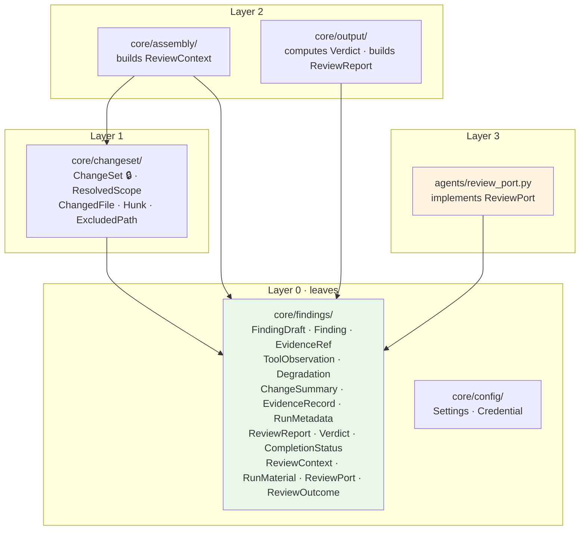
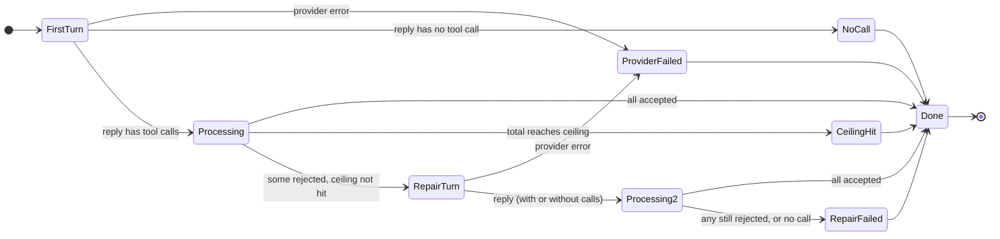

# Data Model: Walking Skeleton

**Feature**: [spec.md](./spec.md) · **Plan**: [plan.md](./plan.md) · **Research**: [research.md](./research.md)

This file **selects** types from [`Docs/design/02-domain-model.md`](../../Docs/design/02-domain-model.md)
for feature 001 and records what 001 adds or narrows. Where they disagree, 02 wins. The design gaps (D-n) cited here
were approved and written back to 02 on 2026-09-17.

**Conventions** (from 02 §0): fields are `snake_case` in Python and `camelCase` in JSON; enum values are
kebab-case literals; 🔒 frozen interface; 📦 part of the published report schema, version `1.0`.

---

## 1 · Where each type lives

**Why the report types sit in `core/findings/`.** 01 §3 lets `core/output/` import only `findings/` and
`patterns/`, yet the report embeds `ChangeSummary` (produced by CF-1) and, later, `EvidenceRecord` (CF-3).
Stack §4 describes `findings/` as "Pydantic models, schema, versioning, the model port". Putting **every 📦
type** there gives the published schema one home and keeps the layering acyclic. Capability packages
produce these types; they do not own them. `ChangeSet` stays in `core/changeset/` because it carries diff
text and never reaches the report.

---

## 2 · CF-1 · The change

### `ChangeSet` 🔒 (`core/changeset/`)

| Field | Type | Rule |
|---|---|---|
| `repo_root` | `Path` | Absolute. Every other path is relative to it |
| `scope` | `ResolvedScope` | |
| `files` | `tuple[ChangedFile, ...]` | Every changed, **non-excluded** path, reviewable or not |
| `excluded` | `tuple[ExcludedPath, ...]` | Dropped at resolution (FR-008) |

Frozen dataclass. Derived, not stored: `reviewable_files` = files where `change_type != deleted`,
`not is_binary`, and `language != other` (FR-009).

### `ResolvedScope` 📦

| Field | JSON | Type | Rule |
|---|---|---|---|
| `kind` | `kind` | `working-tree \| staged \| range` | FR-005 |
| `base_ref` | `baseRef` | `str \| None` | Set if and only if `kind == range`, exactly as the user gave it |
| `head_ref` | `headRef` | `str \| None` | `"HEAD"` if and only if `kind == range` |
| `was_defaulted` | `wasDefaulted` | `bool` | True only when **neither** a flag **nor** the config file named a scope (FR-006) |
| `description` | `description` | `str` | One line, for example `"uncommitted changes in the working tree (default) · 3 files"`; for a range it includes the abbreviated commit IDs |

### `ChangedFile`

| Field | Type | Rule |
|---|---|---|
| `path` | `str` | Repo-relative, POSIX separators |
| `change_type` | `added \| modified \| deleted \| renamed` | Untracked files → `added` (R-4) |
| `previous_path` | `str \| None` | Set if and only if `renamed` |
| `language` | `ts \| tsx \| js \| jsx \| other` | R-7 |
| `is_binary` | `bool` | |
| `changed_line_ranges` | `tuple[tuple[int, int], ...]` | New-file coordinates, 1-based, inclusive; empty when there are no hunks |
| `hunks` | `tuple[Hunk, ...]` | **Empty** for `deleted`, binary, and `other` |

### `Hunk`

`old_start`, `old_count`, `new_start`, `new_count`: `int`; `header: str` (the `@@ … @@` line);
`text: str`, the hunk body **exactly as git produced it**. What is stored is what is sent (02 §3.1).
A hunk's **index** is its position in `ChangedFile.hunks`, starting at 0. That index is how `EvidenceRef.hunkIndex`
refers to it.

### `ExcludedPath` 📦

`path: str` · `rule: str`, where rule is `default:<name>` or `config:<pattern>` (R-6).

### `ChangeSummary` 📦 (`core/findings/`), which is what reaches the report

| Field | Type |
|---|---|
| `scope` | `ResolvedScope` |
| `excluded` | `ExcludedPath[]` |
| `files` | `{ path, changeType, previousPath?, language, isBinary, reviewed: bool, notReviewedReason?, hunkCount, addedLines, removedLines }[]` |

`reviewed` and `notReviewedReason` (`deleted \| binary \| not-typescript-or-javascript`) are **additive
to 02 §3.1**. They make the spec's "listed; not reviewed" edge cases (FR-009) readable from the report without
re-deriving the rule. They contain **no diff text**. Produced by `changeset.summarise(change_set)`.

---

## 3 · CF-5 · Findings

### `FindingDraft` 🔒📦: exactly what the model may emit

Field names are the ones used on the wire (04 §4.1). The shape is flat, not 02's nested `location`: 04 §4.1 and §5
flattened it, and 04 is the later, more specific document.

| JSON field | Type | Validation (shape) |
|---|---|---|
| `file` | `str` | min length 1 |
| `startLine` | `int` | ≥ 1 |
| `endLine` | `int` | ≥ 1, and ≥ `startLine` |
| `severity` | `blocking \| important \| nit` | FR-5.2a |
| `category` | `correctness \| error-handling \| interface-contract \| test-evidence \| security \| performance \| maintainability` | FR-5.2b, closed |
| `rationale` | `str` | min length 1 after trimming whitespace |
| `ruleId` | `str \| absent` | |
| `evidence` | `EvidenceRef` | **required** (FR-5.2c, AC-15) |

`extra="forbid"`: an unknown field is a validation error, naming the field.

### `EvidenceRef`: a union tagged by `kind`

| `kind` | Payload | Reachable in 001? |
|---|---|---|
| `check` | `checkId: tests \| typecheck`, `failingTest?` | Schema: yes. **Reference check: always rejected** ("no checks were run in this review") |
| `context` | `file`, `startLine`, `endLine` | Schema: yes. **Always rejected** ("no related context was gathered in this review") |
| `diff` | `file`, `hunkIndex?` | ✅ |
| `unverified` | `reason` (min length 1) | ✅ |

All four arms exist in schema 1.0, so 002 and 004 **start accepting** existing shapes rather than adding new ones.

### Reference validation against `RunMaterial` (FR-013, gap D-1)

Applied after the shape is valid. Each failure yields a field-precise reason (see
[contracts/emit-finding.md](./contracts/emit-finding.md#rejection-reasons)).

| Rule | Field named |
|---|---|
| `file` is a reviewed file | `file` |
| `endLine ≤ line count` of that file's reviewed version | `endLine` |
| `evidence.kind == diff` → `evidence.file` is a reviewed file | `evidence.file` |
| `evidence.hunkIndex`, if present → `0 ≤ i < hunk count` of `evidence.file` | `evidence.hunkIndex` |
| `evidence.kind == check` → `RunMaterial.check_ids` non-empty (empty in 001) | `evidence.kind` |
| `evidence.kind == context` → `RunMaterial.context_ranges` non-empty (empty in 001) | `evidence.kind` |
| `ruleId` present → it is in `RunMaterial.rule_ids` (empty in 001) | `ruleId` |

### `Finding` 📦 = `FindingDraft` + fields the system assigns

| JSON field | Type | Rule |
|---|---|---|
| `id` | `str` | `f-1`, `f-2`, … in order of acceptance |
| `schemaVersion` | `str` | `"1.0"` |
| `turnIndex` | `int` | 0 = first turn, 1 = repair turn |
| `fingerprint` | `str` | 12 hex characters, position-independent (R-23) |

### `ToolObservation` (FR-015 / FR-5.9)

`status: ok | error | denied` · `reason: str | None`, **required** when status is not `ok` ·
`content: str | None` (for `ok`: `"accepted as f-3"`).
In 001, `denied` is produced for calls beyond the ceiling (R-13).

---

## 4 · CF-4 → CF-6 · What the model is given

### `ReviewContext` (`core/findings/`, produced by `core/assembly/`)

| Field | Type | |
|---|---|---|
| `instructions` | `str` | System message: role, severity and category vocabularies, evidence rules, "findings only via `emit_finding`; prose is discarded; reply without a tool call when done" |
| `material_statement` | `str` | "No checks were run. No related context was gathered." (FR-012). Always present in 001 |
| `diff_section` | `str` | Per reviewable file: a header `path (change type[, renamed from X])`, then each hunk as `[hunk i]` followed by `Hunk.text` **verbatim** |
| `estimated_tokens` | `int` | R-15 |
| `material` | `RunMaterial` | What validation checks references against |

### `RunMaterial`

`reviewed_files: Mapping[str, ReviewedFile]` where `ReviewedFile = {line_count: int, hunk_count: int}` ·
`check_ids: frozenset[str]` (empty) · `context_ranges: tuple` (empty) · `rule_ids: frozenset[str]` (empty).

### `AssemblyResult`

Either `ReviewContext`, or `BudgetExhausted(estimated_tokens, limit)`. The pipeline turns the latter
into a `budget-exhausted` degradation (source `CF-4`) and skips the review stage (FR-019).

---

## 5 · CF-6 · The review step's result

### `ReviewPort` (a protocol in `core/findings/`, implemented in `agents/review_port.py`)

`review(context: ReviewContext) -> ReviewOutcome`. It **never raises** for anything the spec names. Provider
and validation failures come back inside the outcome (Principle V).

### `ReviewOutcome`

| Field | Type |
|---|---|
| `findings` | `tuple[Finding, ...]` |
| `completion_status` | `CompletionStatus` (§6) |
| `degradations` | `tuple[Degradation, ...]` |
| `tool_calls_total` · `tool_calls_emission` · `tool_calls_investigation` · `repair_turns` | `int` |
| `tokens_in` · `tokens_out` | `int \| None`, None when the provider did not report them (FR-021) |
| `model` · `provider` · `temperature` · `seed` | run metadata the agent knows |

### Review-step state machine (from 03 §3, narrowed to 001)

A repair reply **with no tool call** means the rejected findings were never corrected, so it is treated as
`RepairFailed` rather than as `NoCall`.

---

## 6 · Run-level types (📦, `core/findings/`)

### `CompletionStatus`

`emitted` · `nothing-to-review` · `no-tool-call` · `ceiling-reached` · `budget-exhausted` ·
`provider-error` · `invalid-model-output`

02 §3.6 plus `nothing-to-review` and `no-tool-call` (spec gap D-3). The derivation table is in
[research.md R-17](./research.md#r-17--verdict-completion-status-exit-code).

### `Degradation`

| JSON field | Type | Rule |
|---|---|---|
| `source` | `CF-1 … CF-9` | The core function whose stage raised it |
| `code` | `DegradationCode` | Full 02 §3.5 enum is in the schema. **Reachable in 001**: `budget-exhausted` (CF-4), `provider-error`, `invalid-model-output`, `no-tool-call`, `tool-budget-exhausted` (CF-6) |
| `detail` | `str` | Human-readable, **redacted** (R-9) |

### `EvidenceRecord` (001 subset)

`status: not-attempted` · `checks: []` (schema `maxItems: 0` in 1.0, R-22).

### `RunMetadata`

| Group | JSON fields (001) |
|---|---|
| Timing | `startedAt` (ISO-8601 UTC) · `durationMs` · `stageDurationsMs: { preflight, changeSet, assembly?, review?, output }`, containing **only stages that ran** (FR-029) |
| Context | `requestedDepth: null` · `achievedDepth: null`, meaning "not gathered in this build" |
| Agency | `toolCallCeiling` · `investigationToolsEnabled: false` · `completionStatus` · `emitPath: "tool-call"` |
| Counters | `toolCallsTotal` · `toolCallsEmission` · `toolCallsInvestigation` · `repairTurns` (FR-8.2d) |
| Model | `model` · `provider` · `sampling: { temperature, seed }` |
| Budget | `tokensIn` · `tokensOut` · `budgetLimit` · `budgetHit` |
| Versions | `schemaVersion` · `toolVersion` |

For `nothing-to-review` runs, model fields carry the **configured** values and all counters are 0.
**Never present**: the credential, in any field (FR-1.3a).

### `Verdict`

`findings` · `blocking` · `no-findings` · `no-judgement` · `nothing-to-review` (R-17, write-back D-8).

### `ReviewReport`

`schemaVersion` · `run: RunMetadata` · `changeSummary: ChangeSummary` · `context: []` ·
`evidence: EvidenceRecord` · `findings: Finding[]` · `degradations: Degradation[]` (**always present;
empty means clean**) · `verdict: Verdict`.

**Invariants** (asserted in tests):

1. `verdict == blocking` ⇔ ∃ finding with `severity == blocking`.
2. `verdict == no-judgement` ⇔ `completionStatus ∈ {provider-error, invalid-model-output, budget-exhausted}`.
3. `completionStatus == nothing-to-review` ⇒ `findings == []` and no `review` stage duration.
4. `toolCallsTotal == toolCallsEmission + toolCallsInvestigation` and `toolCallsTotal ≤ toolCallCeiling`.
5. `repairTurns ≤ 1`.
6. Every finding's `file` ∈ `changeSummary.files[reviewed == true].path`.
7. Every finding has `evidence` (AC-15).

---

## 7 · CF-9 · Configuration

### `Settings` (`core/config/`)

The full schema from 04 §7 is modelled, so a file written now stays valid later (FR-003). Every section is `extra="forbid"`.

| Path | Type · default | Effect in 001 |
|---|---|---|
| `schemaVersion` | `Literal[1]` · `1` | Validated |
| `scope` | `working-tree \| staged \| range` · `working-tree` | ✅ |
| `exclude` | `list[str]` · `[]` | ✅ Added to the defaults (FR-008) |
| `context.depth` | `int ≥ 0` · `1` | ⚪ ignored, reported |
| `context.node` | `str` · `"node"` | ⚪ ignored, reported |
| `checks.tests.command` / `checks.typecheck.command` | `list[str]`, non-empty · discovered | ⚪ ignored, reported |
| `checks.*.timeoutSeconds` | `int ≥ 1` · `120` **(TBD-4 placeholder)** | ⚪ ignored, reported |
| `agent.toolCallCeiling` | `int ≥ 1` · `25` **(TBD-8 placeholder)** | ✅ |
| `agent.investigationTools` | `bool` · `false` | ⚪ `true` is ignored and reported |
| `agent.model` | `str` · candidate **pending S-1** | ✅ |
| `agent.baseUrl` | `str` (http/https URL) · NIM endpoint | ✅ |
| `agent.temperature` | `float` in `[0, 2]` · `0` | ✅ |
| `agent.requestTimeoutSeconds` | `int ≥ 1` · `60` **(placeholder)**, *additive, D-9* | ✅ |
| `budget.maxTokens` | `int ≥ 1` · `20000` **(TBD-3 placeholder)** | ✅ |

"Ignored, reported" fires only for paths **present in the file** (or `investigationTools: true`), once per run.

### `Credential`

An opaque wrapper whose `__repr__`/`__str__` are masked, carrying `source: environment | user-config` and the
`location` it was read from (the variable name or file path, never the value).
