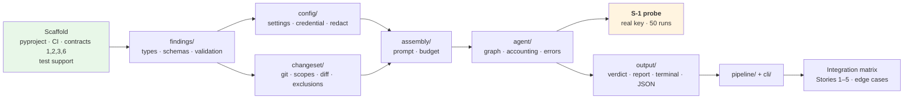

# Implementation Plan: Walking Skeleton — Review a Change, Diff Only

**Branch**: `001-walking-skeleton` | **Date**: 2026-09-17 | **Spec**: [spec.md](./spec.md)

**Input**: Feature specification from `specs/001-walking-skeleton/spec.md`

**Authority**: [`Docs/agentic-code-review-srs-v1.md`](../../Docs/agentic-code-review-srs-v1.md) v1.1 →
[`Docs/technical_stack.md`](../../Docs/technical_stack.md) → [`Docs/adr/`](../../Docs/adr/) →
[`Docs/design/`](../../Docs/design/). This plan selects from those documents and adds no requirement. Where the
documents are silent, the decision is flagged as a **design gap** below, provisional until the maintainer approves it.

## Summary

Build the first runnable slice of the reviewer. `agentic-review review` resolves a working-tree, staged, or range
change set through the git CLI, applies the default and configured exclusions, and sends the complete diff of every
TypeScript/JavaScript file to one model pass. Findings are accepted **only** through the `emit_finding` tool call,
checked against the finding model **and** against what the run actually showed the model, with one repair turn.
The tool prints a Rich terminal summary and, on request, a schema-valid JSON report, and exits 0, 1, 2 or 3.
`agentic-review schema` prints the report schema.

**Technical approach.** The Python package follows the layout in `technical_stack.md` §4, limited to the packages this
feature needs:

- `core/pipeline/` owns the order of operations.
- `core/changeset/` is the only package that runs git.
- `core/assembly/` builds the prompt and owns the token budget.
- `core/findings/` holds every published type: finding model, report schema, validation, and the review port.
- `core/agent/` is the only package importing LangChain or LangGraph. It is a two-node graph whose edge back to the
  model is taken at most once, for the repair turn.
- `core/output/` computes the verdict and renders.
- `cli/` translates flags, streams and exit codes.

Tests run offline, with a scripted stand-in chat model driving the **real** review graph. Import-linter contracts
1, 2, 3 and 6 run in pytest and CI. Test **S-1** runs as soon as `core/agent/` exists, to measure whether the default
model calls the tool.

## Technical Context

**Language/Version**: Python ≥ 3.12 (tested on 3.12 and 3.13) — [research R-1](./research.md#r-1--python-version-and-project-tooling)

**Primary Dependencies**: pydantic v2, PyYAML, Typer, Rich, langchain-core, langchain-openai, LangGraph; the `git`
CLI as an external executable. Exact versions are pinned in `uv.lock` and recorded in `technical_stack.md` §7 in the
first install commit — [R-2](./research.md#r-2--dependencies-and-version-pins)

**Storage**: None. The report is written to a file only on request. No state is kept between runs (FR-5.5 and FR-10.5 are v2)

**Testing**: pytest (unit, integration, structural); import-linter; jsonschema (dev) as an independent schema
validator; a scripted `GenericFakeChatModel` subclass as the stand-in model; network blocked by an autouse fixture —
[R-19](./research.md#r-19--offline-tests-with-a-stand-in-model), [R-20](./research.md#r-20--structural-checks-on-every-commit)

**Target Platform**: Developer workstation — Windows, Linux, macOS. CI on Linux and Windows. Distributed as a
PyPI wheel with a console entry point (`uv tool install` / `pipx`)

**Project Type**: CLI tool — a single Python package (`src/agentic_review/`)

**Performance Goals**: **None set.** The latency a developer tolerates is TBD-2, and no decision in this plan
depends on it (Principle VI). Every stage records its duration on every run (FR-029)

**Constraints**:

- The test suite needs no credential and no network (SC-006).
- The credential never appears in any output (SC-007).
- The diff is never truncated (FR-019).
- After preflight nothing stops a run (FR-022).
- The pipeline is sequential (stack §2).
- Placeholders are labelled wherever they appear:
  - tool-call ceiling 25 (TBD-8)
  - `budget.maxTokens` 20000 (TBD-3)
  - request timeout 60 s
  - default model, pending S-1

**Scale/Scope**: One change set per invocation. The maximum change-set size is TBD-5, bounded in practice by the
token budget refusal (FR-019). The feature adds 2 commands and 7 packages.

## Constitution Check

*GATE: must pass before Phase 0 research, and is re-checked after Phase 1 design (see
[Post-design re-check](#post-design-constitution-re-check)).*

| # | Principle | Gate | Status |
|---|---|---|---|
| I | The documents decide | The spec selects SRS identifiers and adds none. Where the documents are silent, the gap is recorded (D-5, D-7…D-10; D-6 noted as out of scope) rather than settled silently | ✅ Pass. Gaps are flagged for write-back at the approval gate, as the spec did for D-1…D-4 |
| II | Our code owns orchestration | The pipeline order lives in `core/pipeline/`. The framework is imported only by `core/agent/` (contract 3). No step outside the agent branches on model output | ✅ Pass |
| III | One core, thin adapters | The verdict is computed in `core/output/`. The CLI maps verdict → integer only. `ChangeSet` is scope-independent. Nothing imports `cli/` | ✅ Pass |
| IV | Findings enter through one door | Only `emit_finding`. The tool schema is generated from `FindingDraft` and the report schema from `ReviewReport`. Evidence is required. No `tool_choice` | ✅ Pass |
| V | Never silent | Only preflight stops a run. Every degradation appears in both outputs. "No review performed" is worded and exit-coded apart from "no findings". Unbuilt capabilities are stated as not run or not gathered | ✅ Pass, **with D-5 flagged**: at the default, "found nothing" and "never used the tool" are the same model reply. The plan records it honestly and does not hide it |
| VI | Measure, do not argue | No threshold is cited. Placeholders are labelled in config, docs and code. Stage durations are recorded. S-1 produces figures, not a pass/fail verdict | ✅ Pass |
| VII | Offline, structural, fast tests | Tests ship with the feature. The stand-in model and blocked network keep them offline. Contracts 1, 2, 3 and 6 are enabled with the packages that create them. Every reachable failure-matrix row has an integration test | ✅ Pass |

**Engineering constraints**: Python host ✅ · stack layout and contracts ✅ · `shell=False` argv for every
subprocess (git here; checks in 002) ✅ · no credential in the repository or config schema ✅ · pins recorded at the
first install ✅.

**Gate result: PASS.** No violations, so Complexity Tracking is empty.

## Project Structure

### Documentation (this feature)

```text
specs/001-walking-skeleton/
├── spec.md
├── plan.md              # this file
├── research.md          # Phase 0 — R-1 … R-24
├── data-model.md        # Phase 1
├── quickstart.md        # Phase 1 — validation guide
├── contracts/
│   ├── cli.md           # commands, flags, streams, exit codes, preflight messages
│   ├── emit-finding.md  # tool schema, observations, rejection reasons, repair turn
│   ├── review-report.md # JSON report 1.0 as produced by 001; the eight outcomes
│   ├── config.md        # .agentic-review.yml, default exclusions, credential lookup
│   └── internal-seams.md# the Python boundaries the structural principles depend on
├── checklists/requirements.md
├── s1-results.md        # written during implementation by the S-1 probe (not by /speckit-plan)
└── tasks.md             # /speckit-tasks — not created here
```

### Source Code (repository root)

```text
pyproject.toml                    # hatchling; console script agentic-review; [tool.importlinter] contracts 1,2,3,6
uv.lock
.github/workflows/ci.yml          # lint-imports + pytest; ubuntu + windows; py3.12 + 3.13; no secrets
scripts/
└── s1_tool_calling_probe.py      # S-1; needs a real key; not part of pytest
src/agentic_review/
├── __init__.py                   # __version__ via importlib.metadata
├── __main__.py
├── cli/                          # adapter — Typer app, --json argv normalisation, streams, verdict→exit code
│   ├── app.py
│   └── exit_codes.py
└── core/
    ├── pipeline/                 # order of operations; preflight; stage timing
    │   ├── run.py                # run_review()
    │   ├── preflight.py
    │   └── timing.py
    ├── changeset/                # CF-1 — the only package that runs git
    │   ├── _git.py               # subprocess argv wrapper (private)
    │   ├── model.py              # ChangeSet 🔒, ChangedFile, Hunk, ExcludedPath, ScopeRequest
    │   ├── resolve.py            # three scopes, untracked files, unborn HEAD
    │   ├── diff_parser.py        # name-status/numstat/-z parsing, hunk splitting, changed_line_ranges
    │   ├── exclusion.py          # glob translation, default list, rule naming
    │   └── summary.py            # summarise(), measure_new_files()
    ├── assembly/                 # CF-4 (minimum) — prompt sections, token estimate, budget refusal
    │   ├── prompt.py
    │   └── budget.py
    ├── findings/                 # CF-5 — every 📦 type, schema generation, validation, the port
    │   ├── schema.py             # SCHEMA_VERSION, tool_schema(), report_schema(), ref inlining
    │   ├── model.py              # FindingDraft, Finding, EvidenceRef, ToolObservation
    │   ├── report.py             # ChangeSummary, EvidenceRecord, RunMetadata, Degradation, ReviewReport, enums
    │   ├── validation.py         # shape + reference validation, rejection reasons
    │   ├── fingerprint.py
    │   └── port.py               # ReviewPort, ReviewContext, RunMaterial, ReviewOutcome
    ├── agent/                    # CF-6 — the ONLY package importing langchain_* / langgraph / openai
    │   ├── build.py              # build_review_port(), ChatOpenAI construction
    │   ├── graph.py              # call_model ⇄ process_calls, repair edge
    │   ├── accounting.py         # ceiling, counters, denied beyond ceiling
    │   └── provider_errors.py    # exception → provider-error, redaction
    ├── output/                   # CF-7 core side
    │   ├── verdict.py            # compute_verdict()
    │   ├── build.py              # build_report()
    │   ├── json_out.py           # to_json()
    │   └── terminal.py           # render_terminal() — the only Rich import in core
    └── config/                   # CF-9 — settings model, loader, credential, redaction
        ├── settings.py
        ├── loader.py             # duplicate-key-rejecting YAML loader, error formatting, ignored-settings scan
        ├── credentials.py
        └── redact.py
tests/
├── conftest.py                   # network block, canary credential, env isolation
├── support/
│   ├── scripted_chat_model.py    # stand-in model (bind_tools override, scripted replies/errors, call count)
│   ├── repo_builder.py           # git fixture repositories in tmp_path
│   └── report_assertions.py      # schema validation, invariants, canary scan, stage durations
├── structural/
│   ├── test_import_contracts.py  # runs import-linter
│   └── test_git_confinement.py   # AST check: no "git" argv outside core/changeset
├── unit/{changeset,config,findings,assembly,agent,output,cli}/
└── integration/
    ├── test_story1_review_uncommitted.py
    ├── test_story2_failure_modes.py
    ├── test_story3_preflight.py
    ├── test_story4_scopes_and_exclusions.py
    ├── test_story5_machine_output.py
    └── test_edge_cases.py
```

Not created in 001: `core/context/`, `core/execution/`, `core/patterns/`, `resolver/`, `_vendor/`, `tests/corpus/`.
Each arrives with the feature that gives it content (002, 003, 004).

**Structure Decision**: single Python package in the `technical_stack.md` §4 layout, with two refinements:

1. **Every published (📦) type lives in `core/findings/`**, so `core/output/` can build the report while importing
   only `findings/` (01 §3 layering). Capabilities produce these types; they do not own them
   ([data-model §1](./data-model.md#1--where-each-type-lives)).
2. **Rich is confined to one module**, `core/output/terminal.py`, which the pipeline never imports. The CLI calls it.

## Phase 0 — Research (complete)

[research.md](./research.md) resolves every open question. The Technical Context has no
`NEEDS CLARIFICATION` left. Five library assumptions were **verified** against installed libraries rather than trusted:

| Checked | Result | Consequence |
|---|---|---|
| Typer 0.27.2 with an optional-value option (`--json [PATH]`) | **Rejected** by Typer; accepted by Click 8.5 | argv normalisation in `cli/` keeps the documented contract (R-18) |
| `GenericFakeChatModel.bind_tools` | Raises `NotImplementedError` | The stand-in model subclasses it (R-19) |
| Pydantic 2.13 schema for the evidence union | `$defs` + `$ref` + discriminator | The tool schema inlines refs through a tested transform (R-11) |
| `ChatOpenAI.bind_tools` without `tool_choice` | Sets no `tool_choice` kwarg | FR-5.10 holds by default, and a test pins it (R-11) |
| Unreachable endpoint | `APITimeoutError ⊂ APIError`; planted key absent from the message | Error mapping on `openai.APIError`; redaction applied regardless (R-9, R-10) |

## Phase 1 — Design (complete)

| Artifact | Content |
|---|---|
| [data-model.md](./data-model.md) | Types by package, validation rules, review-step state machine, report invariants, config fields and their 001 effect |
| [contracts/cli.md](./contracts/cli.md) | `review` / `schema` / `--version`, streams, exit codes, preflight order and messages |
| [contracts/emit-finding.md](./contracts/emit-finding.md) | Tool schema, binding rules, observations, fixed rejection reasons, repair turn |
| [contracts/review-report.md](./contracts/review-report.md) | Report 1.0 example, the eight outcomes, per-outcome differences |
| [contracts/config.md](./contracts/config.md) | Config file, rules, default exclusion list, credential sources |
| [contracts/internal-seams.md](./contracts/internal-seams.md) | `run_review`, change-set API, `assemble`, `ReviewPort`, validation, output, CLI |
| [quickstart.md](./quickstart.md) | Offline suite, manual offline checks, S-1 and SC-001 with a real key |

### Suggested build order within the feature

This is for `/speckit-tasks` to refine. It follows SRS Appendix A step 1 (CF-1 → CF-5 → CF-7) and puts S-1 as
early as the agent allows.



S-1 does not block G–I, which run against the stand-in model. It does block **SC-001** and the choice of the default
model.

## Design gaps raised by this plan

The spec raised D-1…D-4, and this plan implements them as provisionally decided there. Planning exposed five more
that are in scope for this feature (D-5, D-7…D-10). Following Principle I, none is settled silently: each is decided
**provisionally** so the design can proceed, and each is due for write-back once approved. **All approved and written
back on 2026-09-17.**

**D-6 is out of scope for 001** (maintainer decision, 2026-09-17). It concerns only a stale sentence in
`technical_stack.md` §3.6 ("one node, no cycle"), written before FR-5.6c added the repair turn. It does **not**
change what 001 builds: the repair turn stays in scope (FR-016, US2-AS2/AS3, AC-13), and the review graph is built
as described in [R-12](./research.md#r-12--the-review-steps-graph). Updating the stack document is left to whoever
next edits it. It is not part of 001's approval or write-back. The number is kept, not reused, so references stay valid.

| # | Gap | Provisional decision | Write back to |
|---|---|---|---|
| **D-5** ⚠️ | **"Found nothing" and "never used the tool" are the same model reply** when `emit_finding` is the only tool (investigation off). Every zero-finding run is therefore a `no-tool-call` run. Spec **US2-AS7** (no findings *and* empty degradations) and SC-003's "clean" outcome cannot occur with a real model. ADR-0008 decision 2's claim that the distinction is "obtainable by observing whether any call was made" holds only once investigation tools exist | ✅ **Decided 2026-09-17: reword.** Zero findings → `no-tool-call` status **and** degradation, verdict `no-findings`, exit 0, with plain wording. Spec Story 2 (scenarios 4 and 7) and SC-003 reworded to what this build can distinguish. ADR-0008 is not reopened | ✅ spec Story 2, SC-003; `DESIGN_BLOCKERS.md` response log; `02-domain-model.md` §3.5 |
| **D-7** | Scope **semantics** are undefined: whether untracked files count as uncommitted, and whether a range is two-dot or merge-base | Working tree = `HEAD` ↔ worktree **plus untracked, non-ignored files**; range = merge-base (`base...HEAD`); unborn `HEAD` handled (R-4) | `02-domain-model.md` §3.1 |
| **D-8** | Vocabularies and fields the report needs that design never fixed: the `verdict` values, two new `completionStatus` values, `ChangeSummary.files[].reviewed` and `notReviewedReason`, `null` depths meaning "not gathered", and 📦 types housed in `findings/` for layering | As in [data-model.md](./data-model.md) §2, §6 and [R-17](./research.md#r-17--verdict-completion-status-exit-code), [R-22](./research.md#r-22--schema-versioning-and-the-empty-sections) | `01-logical-architecture.md` §3–§4; `02-domain-model.md` §3.1, §3.6; `04-contracts.md` §5 |
| **D-9** | The spec calls the provider request timeout a placeholder, but 04 §7 has no field for it | Add `agent.requestTimeoutSeconds` (default 60, labelled placeholder). An additive config field | `04-contracts.md` §7 |
| **D-10** | 02 §3.4a and 04 §4.2 say `denied` has no producer in v1. A call beyond the tool-call ceiling is "understood, not permitted", which is exactly `denied` | Calls beyond the ceiling receive `denied` (R-13) | `02-domain-model.md` §3.4a; `04-contracts.md` §4.2 |

Carried from the spec, and done on 2026-09-17: the D-1…D-4 write-backs; `02-domain-model.md` §3.8 no longer calls
DB-06 unanswered; `03-behaviour.md` §6 no longer shows the unmeasured "2–5s" figure. `Docs/Draft/agentic-code-review-srs-ar.md` is unaffected,
because nothing in the catalogue changes.

## Post-design constitution re-check

Re-run against the Phase 1 artifacts.

| # | What the design actually does | Status |
|---|---|---|
| I | Every type and contract cites its source section. Five in-scope gaps raised and one noted as out of scope, none buried. No SRS identifier added, renumbered or relaxed | ✅ |
| II | `run_review` is plain Python with a fixed order. LangGraph appears only in `core/agent/graph.py`, and contract 3 enforces it. The pipeline never inspects model output; it receives a `ReviewOutcome` | ✅ |
| III | `compute_verdict` is in core. `cli/exit_codes.py` is a lookup table. The layers contract makes importing `cli/` a failure. `ChangeSet` has no scope-specific field | ✅ |
| IV | `tool_schema()` and `report_schema()` are generated. A test compares the bound schema with the generated one. `evidence` is required. A test asserts no `tool_choice` | ✅ |
| V | `ReviewPort.review` never raises for a named failure. `degradations` is required in the schema. The terminal wording for `no-judgement` is fixed. D-5 is surfaced to the user in the terminal message itself | ✅ |
| VI | Four placeholders are labelled in config docs and code. The token estimator is named as an estimate. S-1 records figures without a pass mark. Durations are asserted present, never bounded | ✅ |
| VII | Stand-in model, network block and canary key in every integration test. Contracts 1, 2, 3 and 6 are in pytest and CI. Every reachable matrix row (03 §4: preflight ×4, nothing to review, provider error, repair success, repair failure, ceiling, budget, blocking) has a named integration test file | ✅ |

**Result: PASS.**

**Approved by the maintainer on 2026-09-17**, together with D-7…D-10. D-5 was decided by rewording the spec, and D-1…D-5
and D-7…D-10 have been written back to `Docs/design/`. **Next step: `/speckit-tasks`.** S-1 still needs a real
provider key during implementation.

## Complexity Tracking

No constitution violations to justify.
