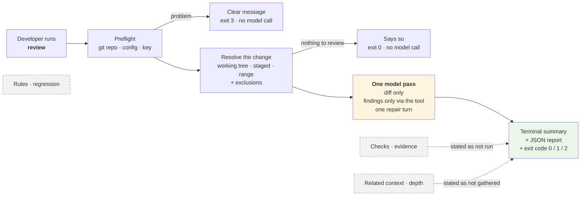

# Feature Specification: Walking Skeleton — Review a Change, Diff Only

**Feature Branch**: `001-walking-skeleton`

**Created**: 2026-09-17

**Status**: Approved 2026-09-17. Design gaps D-1…D-4 approved; D-5 (raised by the plan) decided by rewording Story 2 and SC-003

**Input**: User description: "Feature 1 — the walking skeleton (SRS Appendix A, step 1: CF-1 → CF-5 → CF-7, with the minimum of CF-6 and CF-9 needed to reach a model). A developer runs one review command in a TypeScript/JavaScript git repository. The tool resolves what changed (working tree, staged, or a range), sends only the diff to the model in a single pass, accepts findings only through the validated emit_finding tool call (with one repair turn), and prints a terminal summary plus a schema-valid JSON report with a stable exit code. It must be honest that no checks ran and no related context was gathered in this build. Checks/evidence, the pattern library and regression harness, parsing and related context, investigation tools, and hardening belong to later features."

**Authority**: [`Docs/agentic-code-review-srs-v1.md`](../../Docs/agentic-code-review-srs-v1.md) v1.1 is normative. This spec **selects** requirements from it and adds none. Design detail lives in [`Docs/design/`](../../Docs/design/). Where this file and those disagree, this file is wrong.

---

## What this feature delivers, in one picture

**In one sentence:** a developer can review their own change from the terminal and get findings they can trust the *shape* of — every finding validated, every failure visible — before the tool has any evidence or context to make those findings good.

**What it deliberately does not prove:** that the reviewer is useful. Without test evidence (feature 002) and related context (feature 004), findings come from the diff text alone. This feature proves the pipeline, the finding contract, and honest reporting — the parts every later feature builds on.

---

## User Scenarios & Testing *(mandatory)*

### User Story 1 — Review my uncommitted changes (Priority: P1)

A developer has edited some TypeScript files and has not committed. They run the review command with no options. The tool reviews the uncommitted changes, prints each finding with where it is, how serious it is, what kind it is, and why — then a summary and a verdict.

**Why this priority**: This is the whole walking skeleton. Every later feature adds quality to this path; none of them work without it.

**Independent Test**: In a small fixture repository with one modified `.ts` file, with a stand-in model that emits two valid findings, run the command with no options. Both findings appear in the terminal, the scope is stated as the default, and the exit code reflects the verdict.

**Acceptance Scenarios**:

1. **Given** a git repository with uncommitted changes to `.ts` files and a valid credential, **When** the developer runs the review with no options, **Then** the output states that the uncommitted working-tree changes were reviewed **and that this scope was the default**.
2. **Given** the model emits two valid findings, one `important` and one `nit`, **When** the review completes, **Then** both are shown with file, line range, severity, category, rationale, and evidence (or "unverified" with its reason), the counts by severity read 0 / 1 / 1, and the exit code is **0**.
3. **Given** the model emits one `blocking` finding, **When** the review completes, **Then** the verdict is blocking and the exit code is **1**.
4. **Given** any completed review, **When** the summary is printed, **Then** it states that **no checks were run** and **no related context was gathered in this build** — never that checks passed.
5. **Given** the model emits a finding, **When** the review completes, **Then** the finding in the terminal and the finding in the JSON report are the same finding, field for field.

---

### User Story 2 — "No findings" never pretends to be a clean review (Priority: P2)

A developer sees zero findings. They need to know whether the model was unreachable, answered with garbage, never used the finding tool, or was cut off — and never to be told a change is clean when the tool cannot know that.

**Why this priority**: On a local tool a silent failure is indistinguishable from a clean review (SRS FR-11.2, AC-7). A skeleton that can lie about this teaches users to distrust every later feature.

**A limit of this build, stated rather than hidden (D-5).** The finding tool is the model's only tool, so a model that reviewed the change and found nothing replies exactly as a model that never used the tool does: without a tool call. This build therefore reports **every** zero-finding run as *no tool call* (scenario 4) and never as clean. A run that accepted findings is the only kind that can be free of degradations (scenario 7).

**Independent Test**: With a stand-in model scripted for each failure below, run a review against the same fixture. Each run produces a report, and each is distinguishable from a run whose findings were all accepted without damage, by its exit code, completion status, and recorded degradations.

**Acceptance Scenarios**:

1. **Given** the model provider is unreachable or refuses the request, **When** the review runs, **Then** a report is still produced, it records a provider failure, it says **no judgement was made**, and the exit code is **2**.
2. **Given** the model's only finding fails validation, **When** the review runs, **Then** the model is told exactly which field was wrong and given **one** repair turn; **if** the repaired finding is valid it is reported normally and nothing is recorded as damaged.
3. **Given** the repair turn also fails validation and no finding was accepted, **When** the review completes, **Then** the report records that the model's output could not be validated, says no judgement was made, and exits **2** (AC-13).
4. **Given** the model replies without calling the finding tool at all, **When** the review completes, **Then** the reply is accepted as the end of the review, the report records that **no tool call was made**, and both outputs say plainly that this build cannot tell a change with nothing to report from a model that did not use the finding tool — so the run is never presented as clean (AC-16).
5. **Given** the model keeps calling the tool past the tool-call ceiling, **When** the ceiling is reached, **Then** findings accepted before it are kept, the report records that the ceiling was reached, and the review is reported as completed.
6. **Given** the diff alone is larger than the model can be sent, **When** the review runs, **Then** no partial diff is sent, the report records that the budget was exhausted with nothing reviewed, and the exit code is **2**.
7. **Given** a run in which every finding the model emitted was accepted and nothing was damaged (no provider failure, invalid output, ceiling drop, or budget problem), **When** the JSON report is read, **Then** it carries an **empty** degradation list — an explicit statement that nothing went wrong, not a missing field.

---

### User Story 3 — Fail fast, before spending anything (Priority: P3)

A developer runs the tool outside a repository, with a broken config file, or without a credential. They are told what is wrong immediately, in words that name the problem.

**Why this priority**: Makes AC-9 true by construction, and stops a mistyped key from being discovered only after work has been spent.

**Independent Test**: Run the command in three prepared situations — no git repository, a config with one invalid field, no credential — with a stand-in model that records whether it was called. Each exits **3** with a specific message; the model is called zero times.

**Acceptance Scenarios**:

1. **Given** the current directory is not inside a git repository, **When** the review runs, **Then** it stops with a message saying so and exits **3**.
2. **Given** `.agentic-review.yml` has a field with an invalid value, or a field that does not exist, **When** the review runs, **Then** it stops with a message **naming that field** and exits **3** — it never falls back to defaults silently (FR-1.2d).
3. **Given** no provider credential is available, **When** the review runs, **Then** it stops with a message saying the credential is missing, naming where it may be supplied, and exits **3**.
4. **Given** a range review names a base that does not exist, **When** the review runs, **Then** it stops with a message naming the base and exits **3**.
5. **Given** any preflight failure, **When** the run stops, **Then** the model was not called and no change was resolved.

---

### User Story 4 — Choose what gets reviewed (Priority: P4)

A developer wants to review only what they have staged, or everything on their branch since `main`. Generated and vendored files should never be reviewed, and they should be able to add their own exclusions.

**Why this priority**: FR-10.3a is a Must and the scopes are cheap once one exists, but the default scope alone already makes the feature usable.

**Independent Test**: In a fixture repository with staged and unstaged edits, a two-commit branch, and a changed file under `dist/`, run each scope. Each reviews exactly the expected files, and `dist/` appears only in the excluded list.

**Acceptance Scenarios**:

1. **Given** staged and unstaged edits, **When** the developer selects the staged scope, **Then** only staged changes are reviewed and the scope is stated as chosen, not defaulted.
2. **Given** a branch with commits since a named base, **When** the developer selects a range against that base, **Then** the changes between base and head are reviewed, and both are recorded.
3. **Given** a changed file matching the default exclusion list, **When** any scope is resolved, **Then** the file is not sent to the model and is listed as excluded, with the rule that excluded it.
4. **Given** the config adds an exclusion pattern, **When** a scope is resolved, **Then** that pattern **and** the default exclusions both apply — adding one pattern never removes the defaults.
5. **Given** every changed file is excluded, deleted, binary, or not TypeScript/JavaScript, **When** the scope is resolved, **Then** the tool says there is nothing to review, lists why, does not call the model, and exits **0**.

---

### User Story 5 — Use the result from a script (Priority: P5)

A developer, or the maintainer building the regression harness later, wants a machine-readable result: a JSON report on stdout or in a file, a published schema to validate it against, and exit codes that mean the same thing every time.

**Why this priority**: The JSON report is the foundation feature 003's measurement is built on, but a human can already use the tool without it.

**Independent Test**: Request the JSON report to stdout and to a file for a clean run and for each failure run in Story 2. Every report validates against the schema printed by the schema command, and stdout contains nothing except the JSON document.

**Acceptance Scenarios**:

1. **Given** the developer requests JSON to stdout, **When** the review completes, **Then** stdout contains exactly one JSON document and nothing else; the human-readable summary does not corrupt it.
2. **Given** the developer requests JSON to a file, **When** the review completes, **Then** the file is written and the terminal summary is still shown.
3. **Given** the schema command is run, **When** it completes, **Then** it prints the versioned report schema and exits **0**, without needing a repository or a credential.
4. **Given** any report produced by this feature, **When** it is validated against that schema, **Then** it passes.
5. **Given** a report, **When** it is read, **Then** it records the model and provider, sampling settings, the tool-call ceiling in force, that investigation tools were disabled, all four call counters, the completion status, schema and tool versions, when the run started, how long it took, and how long each stage took.

---

### Edge Cases

- **Renamed file**: reviewed under its new path; its previous path is recorded.
- **Deleted file**: listed in the change summary; no diff text is sent to the model and it is not reviewed.
- **Binary file**: listed in the change summary as binary; not sent, not reviewed.
- **Non-TS/JS file** (for example `README.md`, `package.json`): listed; not sent, not reviewed.
- **Repository root vs subdirectory**: the command works from any directory inside the repository; all paths are repository-relative with forward slashes, on every operating system.
- **Finding for a file that was not reviewed**: rejected at validation, and the repair turn names the problem (FR-013).
- **Finding line range outside the file, or end before start**: rejected at validation (FR-013).
- **Finding citing test results or related context**: rejected — neither exists in this feature's runs (FR-013).
- **Finding naming a pattern rule**: rejected — no rules are loaded in this feature (FR-013).
- **Several findings in one reply, some valid and some not**: valid ones are accepted immediately; only the invalid ones go to the repair turn.
- **Some findings accepted, and the repair turn still fails**: accepted findings are kept and reported; the run records the invalid output as a degradation and is reported as **completed**, not as no judgement (see Assumptions).
- **Model replies with prose and no tool call**: the prose is discarded, never parsed for findings, and the run records that no tool call was made.
- **JSON requested to stdout on an early preflight failure**: stdout carries nothing that could be mistaken for a report; the message goes to the error stream and the exit code is 3.
- **Config sections for capabilities not built yet** (context, checks): accepted if valid, have no effect, and the terminal says once that they were ignored in this build.

---

## Requirements *(mandatory)*

Each requirement names the SRS identifiers it delivers. *Partial* means the SRS requirement is only fully met once a later feature lands.

### Functional Requirements

**Starting a run**

- **FR-001**: The system MUST check, before resolving any change or calling any model, that it is inside a git repository, that the configuration file (if present) is valid, that a provider credential is available, and that any named range base exists. Any failure MUST stop the run with a message naming the specific problem, with exit code 3 and no model call. — *FR-9.3 (partial: test-script check arrives in 002), AC-9*
- **FR-002**: The system MUST read `.agentic-review.yml` from the repository root when present, apply documented defaults when it is absent, apply a field's default when that field is missing, and fail naming the offending field when a value is invalid or a field is unknown. — *FR-1.2a, FR-1.2b, FR-1.2c, FR-1.2d*
- **FR-003**: The system MUST validate the whole documented configuration schema, including sections for capabilities not yet built, so that a configuration written now stays valid later. Settings for unbuilt capabilities MUST have no effect and MUST be reported once as ignored in this build. — *FR-1.2d; `Docs/design/04-contracts.md` §7*
- **FR-004**: The system MUST read the provider credential only from the environment or user-level configuration outside the repository. The configuration file MUST offer no place to put it, and the credential MUST never appear in either output, any log, or any error message. — *FR-1.3a*

**Resolving the change**

- **FR-005**: The system MUST resolve one of three scopes: uncommitted working-tree changes (the documented default), staged changes only, or the changes between a named base and the current head. — *FR-10.3a*
- **FR-006**: The system MUST state the resolved scope in both outputs, and MUST record whether it was chosen or defaulted. — *FR-10.3b*
- **FR-007**: The system MUST represent the change as a list of changed files — each with its change type (added, modified, deleted, renamed), previous path when renamed, whether it is binary, and its diff hunks — in a structure that does not depend on which scope produced it. — *FR-10.3c*
- **FR-008**: The system MUST exclude generated, vendored, and build-output paths using a documented default list merged with any configured patterns, applied when the change is resolved. Every excluded path MUST be recorded with the rule that excluded it. — *FR-3.5*
- **FR-009**: Only text changes to TypeScript and JavaScript files MUST be sent to the model. Deleted, binary, and other-language files MUST be listed in the change summary and not reviewed.
- **FR-010**: When nothing reviewable remains, the system MUST say so with the reason, MUST NOT call the model, and MUST exit 0. A requested JSON report MUST still be written, with a completion status of *nothing to review*.

**The review pass**

- **FR-011**: The system MUST make a single review pass with investigation tools disabled. The only tool offered to the model is the finding-reporting tool. — *FR-5.7a (default off), FR-5.1*
- **FR-012**: The model MUST receive the review instructions and the complete diff text of every reviewable file, exactly as recorded, together with an explicit statement that no checks were run and no related context was gathered, so it cannot assume either. — *FR-2.5b (diff never truncated); `Docs/design/05-cross-cutting.md` §2.4*
- **FR-013**: Findings MUST enter the system only through the finding-reporting tool; any prose the model writes MUST be discarded, never parsed. Each call MUST be validated when it arrives: against the finding model, **and** against what this run actually gave the model — the file must be one that was reviewed, the line range must fall inside that file, the evidence reference must point at something that exists in this run (in this feature: the diff, or *unverified* with a reason), and a named rule must be a loaded rule (in this feature: none are loaded). — *FR-5.6a, FR-0.2, FR-5.6, FR-6.2a (partial)*
- **FR-014**: Each finding MUST carry file, start and end line, severity (`blocking`, `important`, `nit`), category (one of the seven in FR-5.2b), rationale, optionally a rule identifier, and either an evidence reference or an explicit *unverified* marker with a reason — never neither. — *FR-5.2, FR-5.2a, FR-5.2b, FR-5.2c, AC-15*
- **FR-015**: Every tool result returned to the model MUST be a structured observation with a status of *ok*, *error*, or *denied*, and a reason whenever the status is not *ok*. A validation failure MUST name the offending field. — *FR-5.9*
- **FR-016**: When any call fails validation, the system MUST allow exactly **one** repair turn per review, returning the offending fields. The repair turn MUST NOT count against the tool-call ceiling. If the repair also fails, the system MUST record that the model's output could not be validated. — *FR-5.6c, AC-13*
- **FR-017**: The system MUST count every tool call, finding emissions included, against a configurable tool-call ceiling whose default is the SRS §8 placeholder, labelled as a placeholder. Reaching it MUST stop further calls, keep the findings already accepted, and be recorded. — *FR-5.7 (partial: turn-by-turn remaining-calls signal is for investigation, 005)*
- **FR-018**: The system MUST NOT require the model to call a tool. A reply with no tool call MUST be accepted as the end of the review; if it produced no findings, the run MUST record that no tool call was made. — *FR-5.10, AC-16*
- **FR-019**: If the diff alone exceeds the configured context limit, the system MUST NOT send a partial diff; it MUST record that the budget was exhausted with nothing reviewed. The limit's default MUST be labelled as the SRS §8 TBD-3 placeholder. — *FR-2.5b, FR-11.1 (partial)*
- **FR-020**: If the provider is unreachable, times out, or refuses the request, the system MUST still produce both outputs, recording a provider failure. — *FR-11.2*
- **FR-021**: The system MUST record the tokens sent and received whenever the provider reports them. — *FR-11.1 (partial), FR-11.3 (partial)*

**Outcomes and output**

- **FR-022**: After preflight, nothing MUST stop the run. Every failure in FR-016 to FR-020 MUST be recorded as a degradation naming the stage that raised it and a machine-readable reason, and MUST appear in both outputs. — *FR-11.2, FR-8.2e*
- **FR-023**: The system MUST compute the verdict in the core, never in the command-line layer, and MUST map it to exit codes: **0** reviewed with nothing blocking (degraded runs included), **1** reviewed with at least one blocking finding, **2** no judgement made (provider failure, output that could not be validated with no finding accepted, or diff over the limit), **3** could not start. — *FR-10.4c, FR-10.2*
- **FR-024**: The terminal summary MUST state the resolved scope and whether it was defaulted, the excluded paths, that no checks were run, that no related context was gathered, every finding, counts by severity, every degradation, and the verdict. — *FR-8.1b, FR-10.4a*
- **FR-025**: On request, the system MUST write a JSON report to stdout or to a named file, conforming to the published, versioned report schema that embeds the finding model. When written to stdout, stdout MUST contain only that document. — *FR-8.2a, FR-8.2b, FR-10.4b*
- **FR-026**: The report MUST record: run metadata (model, provider, sampling, tool-call ceiling in force, investigation tools disabled, total / emission / investigation call counts and repair turns, completion status — distinguishing at least reviewed, nothing to review, no tool call, ceiling reached, budget exhausted, provider failure, and output that could not be validated — schema and tool versions, start time, total and per-stage durations); a change summary without diff text; an evidence section stating that no checks were executed; context depth recorded as **not gathered**; findings with system-assigned identifier, schema version, turn index and fingerprint; the degradation list (empty when clean); and the verdict. — *FR-8.2c (partial: depth arrives in 004), FR-8.2d, FR-8.2e, FR-0.4*
- **FR-027**: The terminal rendering and the JSON report MUST both be derived from the same result and MUST show the same findings. — *FR-10.4a, FR-5.6*
- **FR-028**: A schema command MUST print the report schema and exit 0 without needing a repository or credential. — *FR-0.4, FR-8.4*
- **FR-029**: Every stage that runs MUST record its duration on every run. — *SRS §8 rule 2, FR-11.3 (partial)*

**Structure and verification** *(tests are required by constitution Principle VII)*

- **FR-030**: Automated structural checks MUST verify, on every commit, the rules this feature's components make checkable: only the output component uses the terminal-rendering dependency; only the change-set component uses git; only the review-step component uses the agent framework; nothing depends on the command-line layer. — *FR-5.8, FR-10.2, AC-10 (partial: the two context-provider clauses arrive in 004)*
- **FR-031**: Automated tests MUST run with no credential and no network, using a stand-in model, and MUST cover every acceptance scenario in Stories 1–5 and every edge case above.

### Traceability to the SRS

A scannable rollup of the trailing italic clause on each requirement above. `src/` and `tests/` cite the SRS column, never this feature's own IDs, per `CLAUDE.md`'s "requirement identifiers" convention — a bare `FR-` in code is always an SRS (`FR-x.y`) identifier.

| Feature ID | SRS ID(s) | Partial — what's missing, closed by | Realised in |
|---|---|---|---|
| FR-001 | FR-9.3 | test-script check — **002** | `core/pipeline/preflight.py` |
| FR-002 | FR-1.2a–d | | `core/config/loader.py` |
| FR-003 | FR-1.2d | | `core/config/loader.py`, `core/config/settings.py` |
| FR-004 | FR-1.3a | | `core/config/credentials.py` |
| FR-005 | FR-10.3a | | `core/changeset/resolve.py` |
| FR-006 | FR-10.3b | | `core/changeset/resolve.py`, `core/changeset/summary.py` |
| FR-007 | FR-10.3c | | `core/changeset/model.py`, `core/changeset/diff_parser.py` |
| FR-008 | FR-3.5 | | `core/config/settings.py`, `core/changeset/exclusion.py` |
| FR-009 | *(none — TS/JS-only scope; a project decision, not an SRS Must)* | | `core/changeset/diff_parser.py` |
| FR-010 | *(none — "nothing to review" outcome; not separately numbered in the SRS)* | | `core/pipeline/run.py`, `core/output/verdict.py` |
| FR-011 | FR-5.7a, FR-5.1 | | `core/agent/build.py`, `core/agent/graph.py` |
| FR-012 | FR-2.5b | | `core/assembly/prompt.py` |
| FR-013 | FR-5.6a | | `core/findings/port.py`, `core/findings/validation.py` |
| FR-014 | FR-5.2, FR-5.2a–c | | `core/findings/model.py` |
| FR-015 | FR-5.9 | | `core/findings/model.py` |
| FR-016 | FR-5.6c | | `core/agent/graph.py` |
| FR-017 | FR-5.7 | turn-by-turn remaining-calls signal — **005** | `core/agent/accounting.py` |
| FR-018 | FR-5.10 | | `core/agent/build.py`, `core/agent/graph.py` |
| FR-019 | FR-2.5b, FR-11.1 | | `core/assembly/budget.py`, `core/assembly/prompt.py` |
| FR-020 | FR-11.2 | | `core/agent/graph.py` |
| FR-021 | FR-11.3 | | `core/agent/accounting.py` |
| FR-022 | FR-11.2 | | `core/pipeline/run.py`, `core/findings/report.py` |
| FR-023 | FR-10.4c | | `core/output/verdict.py`, `cli/exit_codes.py` |
| FR-024 | FR-8.1b | | `core/output/terminal.py` |
| FR-025 | FR-8.2a, FR-10.4b | | `core/output/json_out.py` |
| FR-026 | FR-8.2c, FR-11.3 | context depth — **004** | `core/findings/report.py` |
| FR-027 | FR-10.4a | | `core/output/terminal.py`, `core/output/json_out.py` |
| FR-028 | FR-0.4 | | `cli/app.py` |
| FR-029 | FR-11.3 | | `core/pipeline/timing.py`, `core/findings/report.py` |
| FR-030 | FR-10.3c, FR-5.8, FR-10.2 | context-provider clauses — **004** | `tests/structural/` |
| FR-031 | *(none — Principle VII, constitution)* | | `tests/` |

**No SRS parent**: FR-009, FR-010, FR-031 — each maps to a project or constitution decision, not a numbered SRS Must/Should.

**SRS IDs realised in code with no feature-001 owner**: FR-0.3 (`core/findings/port.py` — the provider-independent interface itself), FR-5.1 (`core/agent/graph.py` — no checkpointer), FR-5.5 (`core/findings/fingerprint.py` — cross-run de-duplication, v2).

A future feature's own traceability subsection follows this same shape, in its own `specs/NNN-*/spec.md`.

### Deliberately not in this feature

| Not delivered | SRS | Arrives in |
|---|---|---|
| Running tests and type-check; evidence in the prompt; test-script prerequisite check | FR-4.1–4.7, FR-2.5c, FR-9.3 (part), AC-2, AC-7 | **002** execution evidence |
| Pattern library, five rules, rule attribution, regression harness, `regression` command, catch predicate | FR-6.1, FR-6.2a–f, FR-6.3a, FR-5.3, AC-4, AC-5 | **003** measurement |
| Parsing, related context, depth option, resolver sidecar, per-section budgets and eviction | FR-2.2–2.6h, FR-2.3c, FR-2.5, FR-2.5a, AC-6, AC-8, AC-12, AC-14 | **004** context quality |
| Investigation tools, `--investigate`, remaining-calls signal | FR-5.7a (enabled), FR-5.7b, FR-5.7c, AC-11 | **005** investigation experiment |
| Structured-output fallback when a provider cannot call tools | FR-5.6b (Should) | After test **S-1**, if it fails |
| README, LICENSE, full usage docs; prompt tuning; diagnostics polish | FR-9.1, CF-6 tuning | **006** hardening |

### Key Entities

- **Resolved scope**: what was reviewed — kind (working tree, staged, range), base and head for a range, whether it was defaulted, a one-line description.
- **Change set**: the reviewed repository's changed files and their hunks, plus excluded paths. Carries diff text inside the run; never written to the report.
- **Change summary**: the change set without diff text — what the report carries.
- **Finding draft**: exactly what the model may report — location, severity, category, rationale, optional rule, evidence reference.
- **Finding**: a draft the system accepted, plus identifier, schema version, turn index and fingerprint the model cannot set.
- **Evidence reference**: what supports a finding — a check result, a related-context unit, the diff, or *unverified* with a reason. Only the last two are reachable in this feature.
- **Tool observation**: the result handed back to the model for each call — status and reason.
- **Degradation**: something that went wrong — the stage that raised it, a machine-readable reason, and a human-readable detail.
- **Run metadata**: model, settings, counters, versions, timings — enough to reproduce and compare a run.
- **Review report**: run metadata, change summary, evidence section, context section, findings, degradations, verdict — one versioned document.

---

## Success Criteria *(mandatory)*

### Measurable Outcomes

- **SC-001**: On a public TypeScript repository with a small staged change, a developer with only a free-tier provider credential gets findings and a verdict from **one command**, with no other setup.
- **SC-002**: **100%** of reports produced across the automated scenarios validate against the published schema.
- **SC-003**: Across the eight outcomes — findings with none blocking, blocking, provider failure, output that could not be validated, no tool call, ceiling reached, diff over limit, nothing to review — **no two outcomes with different meanings produce the same exit code, completion status, and degradation list** — a script can tell every one apart from the report and exit code alone. In this build a zero-finding review is always the *no tool call* outcome (Story 2, D-5).
- **SC-004**: In **100%** of preflight failures the model is called **zero** times, and the message names the specific problem.
- **SC-005**: **0** accepted findings lack both an evidence reference and an unverified reason, and **0** accepted findings refer to a file, line, check, context unit, or rule that the run did not provide.
- **SC-006**: The full automated test suite passes on a machine with **no credential and no network access**.
- **SC-007**: A planted credential value appears in **0 bytes** of terminal output, report, and logs across every automated scenario.
- **SC-008**: **100%** of runs record a duration for every stage that ran.
- **SC-009**: Adding an exclusion pattern in configuration leaves **100%** of the default exclusions in force.

---

## Assumptions

- **Users**: the developer reviewing their own change before pushing, and the contributors building this system (SRS §2.2). Not yet the reviewer clearing a queue (SRS R-5).
- **Tool calling works on the default provider.** This is untested assumption **S-1** (`Docs/technical_stack.md` §7). The plan should run S-1 early, using this feature's review step as the harness. If it fails, the structured-output fallback (FR-5.6b) becomes necessary before this feature can meet SC-001; the finding contract and validation in this spec do not change.
- **Placeholders**: the tool-call ceiling (25, TBD-8), the context limit (TBD-3), and the provider request timeout are placeholders, labelled wherever they appear. No decision in this feature is justified by their values.
- **Some findings accepted, repair still failing**: reported as **completed with a degradation** (exit 0 or 1), not as no judgement (exit 2). FR-10.4c reserves exit 2 for "a review that could not be produced", and a review with validated findings was produced. *Design gap D-4 below.*
- **No tool call and no findings**: reported as **completed with a degradation** (exit 0). FR-5.10 says such a reply "shall be accepted" as termination; the degradation keeps it distinguishable (AC-16). With investigation off this is also how a model reports finding nothing, so it is never presented as clean. *Design gaps D-3 and D-5 below.*
- **Unknown configuration fields are errors**, not ignored: a misspelt field silently falling back to its default is the failure FR-1.2d forbids.
- **Options for unbuilt capabilities are not offered** (`--depth`, `--no-checks`, `--investigate`). They arrive with the feature that makes them mean something, rather than being accepted and ignored.
- **The prompt is deliberately minimal.** Prompt quality is measured and tuned only after feature 003 exists (SRS Appendix A).
- **Terminal colour and layout** follow common CLI conventions and degrade to plain text when output is not a terminal.

---

## Design gaps raised by this spec

Writing testable requirements exposed four places where `Docs/design/` is silent or incomplete. Constitution Principle I says these must not be settled only inside a spec. Each is decided above **provisionally**, and should be written back into the design documents once approved.

| # | Gap | Provisional decision | Design file to update |
|---|---|---|---|
| **D-1** | Validation checks a finding's **shape**, but nothing checks that its file, lines, evidence reference, or rule **exist in this run**. A model could cite a test result when no tests ran, and it would be accepted as evidenced — undoing AC-15's intent. | Validate references against the run's actual material; a dangling reference is a validation error and goes to the repair turn (FR-013) | `02-domain-model.md` §3.4, `04-contracts.md` §4.1 |
| **D-2** | The failure matrix has no row for **the diff alone exceeding the window**. `05-cross-cutting.md` §1.1 says it is "budget-exhausted with nothing reviewed", but the only matrix row for `budget-exhausted` exits 0. | Exit **2** — nothing was reviewed, so no judgement was made (FR-019, FR-023) | `03-behaviour.md` §4 |
| **D-3** | The failure matrix has no row for **no tool call** (`no-tool-call`, FR-5.10), and the completion status in `RunMetadata` has no value for it **or** for *nothing to review* — so a clean review and an empty change set produce identical reports. | Exit **0** with the degradation recorded; completion status gains both values (FR-026) | `03-behaviour.md` §4, `02-domain-model.md` §3.6 |
| **D-4** | "The repair turn also fails → exit 2" does not say what happens when **other findings in the same run were valid**. | Exit 2 only if **no** finding was accepted; otherwise completed with a degradation | `03-behaviour.md` §4 |

**All four approved 2026-09-17** and written back into `Docs/design/`.

**D-5**, raised by [the plan](./plan.md#design-gaps-raised-by-this-plan): with the finding tool as the only tool, "found nothing" and "never used the tool" are the same model reply, so the original Story 2 scenario 7 and SC-003's "clean" outcome could not occur with a real model. **Decided 2026-09-17: reword** — Story 2, scenarios 4 and 7, and SC-003 now say what this build can actually distinguish. No requirement changed; ADR-0008 is not reopened.

Two stale lines found earlier were also due for correction, and have been corrected: `02-domain-model.md` §3.8 still calls DB-06 unanswered, and `03-behaviour.md` §6 shows an unmeasured "2–5s" model-call figure.
