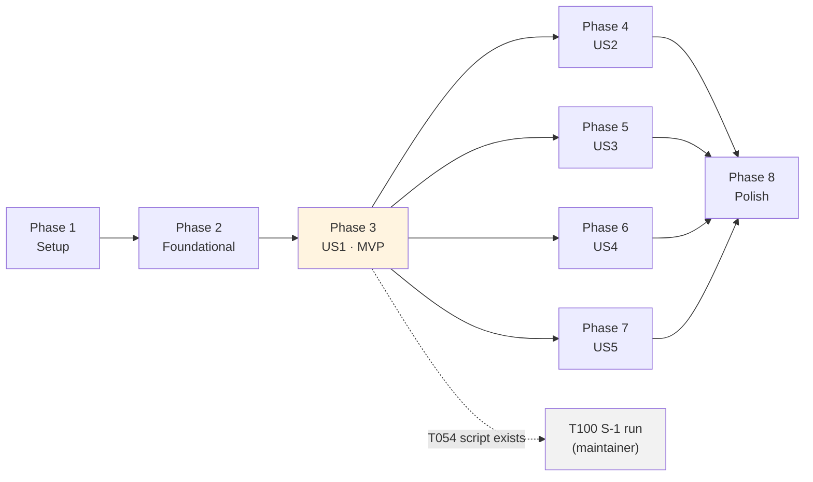

# Tasks: Walking Skeleton — Review a Change, Diff Only

**Input**: Design documents from `specs/001-walking-skeleton/`

**Prerequisites**: [plan.md](./plan.md), [spec.md](./spec.md), [research.md](./research.md),
[data-model.md](./data-model.md), [contracts/](./contracts/), [quickstart.md](./quickstart.md)

**Tests**: **Required.** Constitution Principle VII and spec FR-030/FR-031 make tests part of the feature. Within each
phase, test tasks come first and are expected to fail until the implementation tasks after them land.

**Authority**: these tasks select from the documents above and add no requirement. A task that seems to need a
decision the documents do not make stops and reports it (Principle I) — it is not settled inside the code.

**Organization**: grouped by user story (spec.md priorities P1–P5), so each story is a testable increment.

## Format: `[ID] [P?] [Story] Description`

- **[P]**: can run in parallel (different files, no dependency on an unfinished task)
- **[Story]**: US1…US5, mapping to spec.md User Stories 1–5
- Paths are repository-relative. Source lives in `src/agentic_review/`, tests in `tests/` (plan.md "Project Structure")

## Rules that apply to every task

- `subprocess` is always called with an argv list and `shell=False`. Only `core/changeset/_git.py` runs git.
- `langchain_*`, `langgraph` and `openai` are imported only under `core/agent/`. `rich` only in `core/output/terminal.py` and `cli/`.
- Placeholders (tool-call ceiling 25 · TBD-8, `budget.maxTokens` 20000 · TBD-3, request timeout 60 s, default model
  pending S-1) carry a `PLACEHOLDER` comment wherever they are defined.
- No credential value ever reaches stdout, stderr, the report, a log record or an exception message (FR-004, SC-007).
- Every 📦 type lives in `core/findings/` (data-model.md §1). JSON field names are camelCase aliases of snake_case fields.

---

## Phase 1: Setup (Shared Infrastructure)

**Purpose**: an installable, empty package with the structural contracts and CI already in force.

- [X] T001 Create `pyproject.toml`: project `agentic-review` version `0.1.0`, `requires-python = ">=3.12"`, hatchling build backend with `src/agentic_review` as the package, console script `agentic-review = "agentic_review.cli.app:main"`, runtime deps `pydantic`, `pyyaml`, `typer`, `rich`, `langchain-core`, `langchain-openai`, `langgraph`; dev dependency group `pytest`, `import-linter`, `jsonschema`; `[tool.pytest.ini_options]` with `testpaths = ["tests"]` (research R-1, R-2)
- [X] T002 Add `[tool.importlinter]` to `pyproject.toml` with `root_package = "agentic_review"` and contracts 1, 2, 3 (forbidden, `allow_indirect_imports = true`) and 6 (layers `agentic_review.cli` > `agentic_review.core.pipeline` > `agentic_review.core.agent` > `agentic_review.core.assembly | agentic_review.core.output` > `agentic_review.core.changeset` > `agentic_review.core.findings | agentic_review.core.config`) exactly as research R-20 states
- [X] T003 [P] Create `.gitignore` with Python patterns (`__pycache__/`, `*.pyc`, `.venv/`, `venv/`, `dist/`, `build/`, `*.egg-info/`, `.pytest_cache/`, `.import_linter_cache/`) and universal patterns (`.DS_Store`, `Thumbs.db`, `*.tmp`, `*.swp`, `.env*`)
- [X] T004 [P] Create the package skeleton with an `__init__.py` in every package of plan.md "Project Structure": `src/agentic_review/{__init__,__main__}.py`, `cli/`, `core/`, `core/{pipeline,changeset,assembly,findings,agent,output,config}/`; `__init__.py` exposes `__version__` via `importlib.metadata.version("agentic-review")`; `__main__.py` calls `cli.app.main`
- [X] T005 [P] Create empty test packages `tests/__init__.py`, `tests/support/__init__.py`, `tests/structural/`, `tests/unit/{changeset,config,findings,assembly,agent,output,cli}/`, `tests/integration/` (each with `__init__.py`)
- [X] T006 Run `uv sync` to create `uv.lock`; confirm `uv run lint-imports` reports the four contracts KEPT on the empty skeleton; record the resolved exact versions (pydantic, pyyaml, typer, rich, langchain-core, langchain-openai, langgraph, openai, pytest, import-linter, jsonschema) in `Docs/technical_stack.md` §7, stating that they were pinned by feature 001's first install (stack §7 rule)
- [X] T007 [P] Create `.github/workflows/ci.yml`: on push and pull_request, matrix `ubuntu-latest` + `windows-latest` × Python `3.12` + `3.13`, `astral-sh/setup-uv`, `uv sync`, `uv run lint-imports`, `uv run pytest`; no secrets referenced (research R-20, SC-006)

**Checkpoint**: `uv sync` succeeds, `uv run lint-imports` passes, CI definition exists.

---

## Phase 2: Foundational (Blocking Prerequisites)

**Purpose**: the test harness, every published type, configuration, and the change-set producer. Every user story depends on these.

**⚠️ CRITICAL**: no user-story work begins until this phase is complete.

### Test harness and structural checks

- [X] T008 Create `tests/conftest.py`: an autouse fixture that patches `socket.socket.connect` (and `connect_ex`) to raise, so any network use fails the test; an autouse fixture that removes `AGENTIC_REVIEW_API_KEY` and `AGENTIC_REVIEW_DEBUG` from the environment and points `APPDATA`, `XDG_CONFIG_HOME` and `HOME` at a per-test temp directory; a `CANARY_KEY` constant (a distinctive value such as `ar-canary-9f3b2c7d51e84a06`) and a `canary_env` fixture that sets it (research R-19, SC-006, SC-007)
- [X] T009 [P] Create `tests/support/repo_builder.py`: a `RepoBuilder(tmp_path)` helper that runs the git CLI by argv (`shell=False`) to `init` (setting local `user.name`, `user.email`, `core.autocrlf=false`), `write(path, text)`, `write_bytes(path, data)`, `stage(*paths)`, `commit(msg)`, `rename(old, new)`, `delete(path)`, `branch(name)`, `checkout(name)`; returns the repo root (research R-19)
- [X] T010 [P] Create `tests/support/scripted_chat_model.py`: `ScriptedChatModel`, a subclass of `langchain_core.language_models.fake_chat_models.GenericFakeChatModel` that replays a scripted list of `AIMessage`s or exceptions (an `openai.APIError` instance is raised when reached), overrides `bind_tools` to record the tools and kwargs and return itself, and counts invocations in `call_count`; helper constructors `finding_call(**fields)` and `ai_reply(tool_calls=..., invalid_tool_calls=..., usage=...)` (research R-19)
- [X] T011 [P] Create `tests/structural/test_import_contracts.py`: runs `lint-imports` (via `subprocess` argv from the active interpreter's scripts dir, or the `importlinter` API) and asserts every contract is KEPT, so a plain `pytest` fails on a violation (FR-030, research R-20)
- [X] T012 [P] Create `tests/structural/test_git_confinement.py`: walks `src/agentic_review/**/*.py` with `ast`, and fails if any module outside `src/agentic_review/core/changeset/` calls a `subprocess` function whose first argv element is the literal `"git"` (FR-030, research R-3). It scans `src/` only; `tests/support/repo_builder.py` is test tooling and legitimately runs git

### `core/findings/` — every published type, schemas, validation (CF-5)

- [X] T013 [P] Write `tests/unit/findings/test_model.py`: `FindingDraft` accepts a valid draft for each of the four evidence arms; rejects a missing `evidence`, an unknown field (`extra="forbid"`), `startLine < 1`, `endLine < startLine`, whitespace-only `rationale`, an unknown `severity` or `category`, `unverified` with an empty `reason`; serialises with camelCase aliases (data-model §3, FR-014, AC-15)
- [X] T014 [P] Write `tests/unit/findings/test_schema.py`: `inline_refs` leaves no `$ref`/`$defs`/`title` keys; `tool_schema()` equals `inline_refs(FindingDraft.model_json_schema(by_alias=True))` and requires the seven fields of contracts/emit-finding.md; `report_schema()` is draft 2020-12, its `$id` contains `1.0`, its `description` says consumers must ignore unknown fields, `degradations` is required, `context` and `evidence.checks` have `maxItems: 0`, `requestedDepth`/`achievedDepth` allow null, and `DegradationCode` lists all ten codes of `Docs/design/02-domain-model.md` §3.5 (research R-11, R-22)
- [X] T015 [P] Write `tests/unit/findings/test_validation.py`: one test per row of the "Rejection reasons" table in contracts/emit-finding.md asserting the **exact** reason string; a shape failure names its dotted field path; several failures are joined with `; `; a valid call against a `RunMaterial` returns `Accepted` with the parsed draft (FR-013, FR-015, gap D-1)
- [X] T016 [P] Write `tests/unit/findings/test_fingerprint.py`: 12 lowercase hex characters; equals `sha256("fp1\0" + file + "\0" + category + "\0" + (ruleId or ""))[:12]`; unchanged when lines, severity or rationale change; changes with file or category (research R-23)
- [X] T017 Implement `src/agentic_review/core/findings/model.py`: `Severity`, `Category` literals; the four evidence models (`CheckEvidence`, `ContextEvidence`, `DiffEvidence`, `UnverifiedEvidence`) as a `kind`-discriminated union `EvidenceRef`; `FindingDraft` (flat wire shape, `extra="forbid"`, camelCase aliases, `endLine ≥ startLine` validator, trimmed non-empty rationale); `Finding` = draft + `id`, `schemaVersion`, `turnIndex`, `fingerprint`; `ToolObservation` (`status: ok|error|denied`, `reason` required unless ok, `content`) (data-model §3)
- [X] T018 Implement `src/agentic_review/core/findings/report.py`: `ScopeKind`, `ResolvedScope`, `ExcludedPath`, `FileSummary` (with `reviewed`, `notReviewedReason: deleted|binary|not-typescript-or-javascript`), `ChangeSummary`, `EvidenceRecord` (`status: not-attempted`, `checks` max 0 items), `DegradationCode` (all ten codes of 02 §3.5), `Degradation` (`source` CF-1…CF-9, `code`, `detail`), `CompletionStatus` (seven values), `Verdict` (five values), `Sampling`, `RunMetadata` (every field of data-model §6, `stageDurationsMs` holding only stages that ran, `emitPath: "tool-call"`), `ReviewReport` (`context` max 0 items, `degradations` required) (data-model §2, §6)
- [X] T019 [P] Implement `src/agentic_review/core/findings/port.py`: `ReviewedFile(line_count, hunk_count)`, `RunMaterial` (reviewed files mapping; empty `check_ids`, `context_ranges`, `rule_ids`), `ReviewContext` (`instructions`, `material_statement`, `diff_section`, `estimated_tokens`, `material`), `ReviewOutcome` (all fields of data-model §5), and the `ReviewPort` protocol with `review(context) -> ReviewOutcome` (contracts/internal-seams.md §4)
- [X] T020 [P] Implement `src/agentic_review/core/findings/fingerprint.py`: `fingerprint(draft) -> str` per research R-23
- [X] T021 Implement `src/agentic_review/core/findings/schema.py`: `SCHEMA_VERSION = "1.0"` (hand-set, never derived from the package version); `inline_refs(schema)` that resolves `$ref` against `$defs`, drops `$defs` and `title`; `tool_schema()`; `report_schema()` generated from `ReviewReport` with `$schema` 2020-12, versioned `$id`, the unknown-fields description, and the null-depth description (research R-11, R-22)
- [X] T022 Implement `src/agentic_review/core/findings/validation.py`: `Accepted(draft)`, `Rejected(reason)`, `validate_call(name, args, material)` — unknown tool name, then shape via `FindingDraft.model_validate` rendered as `dotted.path: message` joined by `; `, then reference checks in the order of data-model §3 with the fixed reason strings of contracts/emit-finding.md; `invalid_json_rejection()` for `arguments: not valid JSON` (research R-14)
- [X] T023 Create `tests/support/report_assertions.py`: `assert_valid_report(report_or_json)` validating with `jsonschema` (Draft 2020-12) against `report_schema()`; `assert_invariants(report)` for invariants 1–7 of data-model §6; `assert_no_canary(*texts)` scanning for `CANARY_KEY`; `assert_stage_durations(report, expected_stages)` checking keys present and values ≥ 0, never bounded (SC-002, SC-007, SC-008)

### `core/config/` — settings, credential, redaction (CF-9)

- [X] T024 [P] Write `tests/unit/config/test_settings.py`: defaults match data-model §7 (placeholders included); `schemaVersion` must be 1; every section rejects unknown keys; `agent.toolCallCeiling ≥ 1`; `agent.temperature` in [0, 2]; `agent.baseUrl` must be http(s); `checks.*.command` non-empty; there is no field that could hold a credential (FR-002, FR-003, FR-004)
- [X] T025 [P] Write `tests/unit/config/test_loader.py`: absent file → defaults; a file setting one `agent` field keeps the other `agent` defaults (per-field merge); an unknown field, a duplicate key and an invalid value each raise `ConfigError` naming the file and dotted field path; a YAML syntax error names line and column; `apiKey` anywhere is an unknown field; `ignored_settings()` lists only the `context.*`/`checks.*` paths present in the file, plus `agent.investigationTools` only when `true` (FR-002, FR-003, research R-8)
- [X] T026 [P] Write `tests/unit/config/test_credentials.py`: environment variable wins; the user-level file (`%APPDATA%\agentic-review\credentials.yml` on Windows, `$XDG_CONFIG_HOME` then `~/.config` elsewhere) is read when the variable is absent; a user-level path inside the repository root is refused; neither present → `CredentialMissing` whose message names `AGENTIC_REVIEW_API_KEY` and the user-level path; `repr()`/`str()` of the credential never contain the value (FR-004, research R-9)
- [X] T027 [P] Write `tests/unit/config/test_redact.py`: `redact(text, secret)` replaces every occurrence; handles `None`/empty secret; leaves text without the secret unchanged
- [X] T028 [P] Implement `src/agentic_review/core/config/settings.py`: Pydantic `Settings` with `ContextSettings`, `CheckSettings`/`ChecksSettings`, `AgentSettings`, `BudgetSettings`, all `extra="forbid"` with camelCase aliases and the defaults of data-model §7, each placeholder labelled `PLACEHOLDER` with its TBD
- [X] T029 [P] Implement `src/agentic_review/core/config/redact.py`: `redact(text, secret) -> str`
- [X] T030 Implement `src/agentic_review/core/config/loader.py`: a `yaml.SafeLoader` subclass rejecting duplicate keys; `load_settings(path: Path | None, explicit: bool) -> LoadedSettings(settings, ignored_settings)`; `ConfigError(message)` formatted as contracts/cli.md's example (`Error in <file>` / `  <dotted.path>: <message>` / `Nothing was reviewed. Fix the field above and re-run.`); an explicit path that does not exist is a `ConfigError` (research R-8)
- [X] T031 Implement `src/agentic_review/core/config/credentials.py`: `Credential` (masked `repr`/`str`, `.reveal()`, `source`, `location`), `user_credential_path(env)`, `find_credential(env, repo_root) -> Credential | CredentialMissing` (contracts/config.md "The credential")

### `core/changeset/` — the change set, working-tree scope, exclusions (CF-1)

- [X] T032 [P] Write `tests/unit/changeset/test_diff_parser.py` on literal git output: `--name-status -z -M` parsing (A, M, D, R<score> with previous path); `--numstat -z -M` binary detection (`-\t-`); patch split on `diff --git` headers and `@@` hunk headers; `Hunk.text` kept verbatim including CRLF; `changed_line_ranges` from `+` lines in new-file coordinates; language from extension per research R-7 (FR-007, FR-009)
- [X] T033 [P] Write `tests/unit/changeset/test_exclusion.py`: glob semantics (`**` zero or more segments, `*`/`?` within one segment, pattern without `/` matches at any depth); every default pattern of contracts/config.md excludes a sample path with the right `default:<name>` rule; a configured pattern yields `config:<pattern>`; a path matching both records the default rule; adding a configured pattern leaves 100% of the defaults in force; a renamed file is judged by its new path (FR-008, SC-009, research R-6)
- [X] T034 [P] Write `tests/unit/changeset/test_resolve_working_tree.py` using `RepoBuilder`: modified tracked file; untracked non-ignored file → `added` with one synthesised hunk; ignored file absent; deleted file with no hunks; renamed file with `previous_path`; binary file (NUL byte) with no hunks; `README.md` listed with language `other` and no hunks; running from a subdirectory gives repo-relative POSIX paths; unborn `HEAD` works; `reviewable_files` excludes deleted/binary/other; `locate_repository` returns `None` outside a repo; `ref_exists`; `head_is_unborn` (FR-005, FR-007, FR-009, research R-4, R-5)
- [X] T035 [P] Write `tests/unit/changeset/test_summary.py`: `summarise` produces a `ChangeSummary` with no diff text, correct `reviewed`/`notReviewedReason`, hunk and line counts; `measure_new_files` returns line counts of the reviewed version for reviewable files only (data-model §2, research R-5)
- [X] T036 [P] Implement `src/agentic_review/core/changeset/model.py`: frozen dataclasses `Hunk`, `ChangedFile`, `ChangeSet` (with derived `reviewable_files`), `ScopeRequest(kind, base)`, and `language_for(path)`; `ChangeSet` imports `ResolvedScope`/`ExcludedPath` from `core/findings/report.py` (data-model §2). `ChangedFile` also carries `added_lines`/`removed_lines` from `--numstat`: `ChangeSummary` reports them, including for binary and other-language files that have no hunks, and data-model §2 does not list a source for them
- [X] T037 [P] Implement `src/agentic_review/core/changeset/_git.py`: `run_git(repo_root, *args) -> str` using `subprocess.run(["git", "-c", "core.quotepath=off", *args], shell=False, capture_output=True)`, UTF-8 decode with `errors="replace"`, raising `GitError(args, stderr)` on non-zero exit; `run_git_bytes` for raw output; the only module that executes git (research R-3, R-5)
- [X] T038 [P] Implement `src/agentic_review/core/changeset/exclusion.py`: `DEFAULT_EXCLUSIONS` (rule name → patterns, contracts/config.md), `glob_to_regex(pattern)`, `classify(path, configured) -> str | None` returning the rule name, defaults checked first (research R-6)
- [X] T039 Implement `src/agentic_review/core/changeset/diff_parser.py`: `parse_name_status(z_output)`, `parse_numstat(z_output)`, `split_patch(patch) -> dict[path, list[Hunk]]`, `changed_line_ranges(hunks)`, `synthesise_added_file(text) -> Hunk` (depends on T036)
- [X] T040 Implement `src/agentic_review/core/changeset/resolve.py`: `locate_repository(cwd)`, `ref_exists(repo_root, ref)`, `head_is_unborn(repo_root)`, and `resolve(repo_root, scope, exclude, *, was_defaulted)` for the **working-tree** scope (`git diff HEAD`, or the empty tree when `HEAD` is unborn, plus `git ls-files --others --exclude-standard`), applying exclusions at resolution, building `ResolvedScope` with its one-line description; `staged` and `range` raise `NotImplementedError` until US4 (research R-4, R-5; depends on T037–T039)
- [X] T041 Implement `src/agentic_review/core/changeset/summary.py`: `summarise(change_set) -> ChangeSummary` and `measure_new_files(change_set) -> Mapping[str, int]` reading the working-tree file for the working-tree scope (research R-5)

**Checkpoint**: `uv run pytest tests/structural tests/unit` and `uv run lint-imports` pass. Commit: `feat(core): add findings model, config, and change-set resolution`.

---

## Phase 3: User Story 1 — Review my uncommitted changes (Priority: P1) 🎯 MVP

**Goal**: `agentic-review review` with no options reviews the uncommitted working-tree change in one model pass and prints findings, counts and a verdict with the matching exit code.

**Independent Test**: fixture repo with one modified `.ts` file, stand-in model emitting two valid findings, run with no options → both findings in the terminal, scope stated as the default, exit code matches the verdict.

### Tests for User Story 1 ⚠️ write first

- [X] T042 [P] [US1] Write `tests/unit/assembly/test_prompt.py`: `assemble` puts every reviewable file's hunks into `diff_section` verbatim under `path (change type[, renamed from X])` and `[hunk i]` headers; `material_statement` is "No checks were run. No related context was gathered."; non-reviewable files are absent; `RunMaterial` carries line and hunk counts for reviewed files and empty check/context/rule sets; `estimated_tokens == ceil(len(prompt) / 3)` (FR-012, research R-15)
- [X] T043 [P] [US1] Write `tests/unit/agent/test_binding.py`: with `ScriptedChatModel`, exactly one tool named `emit_finding` is bound, its parameters equal `tool_schema()`, and the bound kwargs contain no `tool_choice` (FR-011, FR-018, contracts/emit-finding.md "Binding rules")
- [X] T044 [P] [US1] Write `tests/unit/agent/test_graph_happy_path.py`: a reply with two valid calls → two `Finding`s with ids `f-1`, `f-2`, `turnIndex 0`, fingerprints, `completion_status == emitted`, `toolCallsTotal == toolCallsEmission == 2`, `repairTurns == 0`; each call got a `ToolMessage` whose JSON is `{"status": "ok", "reason": null, "content": "accepted as f-n"}`; a reply whose prose contains finding-like JSON but no tool call yields 0 findings, completion `no-tool-call` and a `no-tool-call` degradation (source `CF-6`), so an MVP run with zero findings is never presented as clean; `tokens_in`/`tokens_out` copied from `usage_metadata`, `None` when absent (FR-013, FR-015, FR-021)
- [X] T045 [P] [US1] Write `tests/unit/output/test_verdict.py`: every row of research R-17's table maps to its verdict (FR-023)
- [X] T046 [P] [US1] Write `tests/unit/output/test_render.py`: from one `ReviewReport`, the terminal text (Rich console recording, no colour) contains in order the scope line with `(default)`, reviewed and not-reviewed files with reasons, excluded paths with rules, "No checks were run in this build.", "No related context was gathered in this build.", each finding as `path:start-end` with severity, category, rationale and evidence, counts `blocking / important / nit`, each degradation, and the verdict line; `no-judgement` prints "No review was performed"; `to_json` output parses back to an equal report (FR-024, FR-027, contracts/cli.md "Terminal summary")
- [X] T047 [P] [US1] Write `tests/unit/cli/test_exit_codes.py`: `findings`/`no-findings`/`nothing-to-review` → 0, `blocking` → 1, `no-judgement` → 2 (FR-023)
- [X] T048 [US1] Write `tests/integration/test_story1_review_uncommitted.py` covering US1 acceptance scenarios 1–5 through both `run_review` (with an injected `ScriptedChatModel`-backed port and `canary_env`) and the Typer app via `typer.testing.CliRunner`: scope stated and defaulted; an `important` + `nit` pair shows every field and counts 0/1/1 with exit 0; one `blocking` finding → verdict `blocking`, exit 1; "no checks were run" and "no related context was gathered" always present; terminal findings equal JSON findings field for field. Every report passes `assert_valid_report`, `assert_invariants`, `assert_no_canary` and `assert_stage_durations(preflight, changeSet, assembly, review, output)` (SC-002, SC-007, SC-008)

### Implementation for User Story 1

- [X] T049 [P] [US1] Implement `src/agentic_review/core/assembly/budget.py`: `estimate_tokens(text) -> int` = `ceil(len(text) / 3)`, documented as an estimate, not a tokenizer count (research R-15)
- [X] T050 [US1] Implement `src/agentic_review/core/assembly/prompt.py`: `INSTRUCTIONS` (role, severity and category vocabularies, evidence rules, "findings only via emit_finding; prose is discarded; reply without a tool call when done"), `MATERIAL_STATEMENT`, and `assemble(change_set, line_counts, budget) -> ReviewContext` building the diff section and `RunMaterial` (data-model §4, contracts/internal-seams.md §3)
- [X] T051 [P] [US1] Implement `src/agentic_review/core/agent/accounting.py`: a `CallAccounting` object holding `tool_calls_total`, `tool_calls_emission`, `tool_calls_investigation` (always 0), `repair_turns`, accepted findings with sequential `f-n` ids, and token totals summed across turns (research R-13)
- [X] T052 [US1] Implement `src/agentic_review/core/agent/graph.py`: a LangGraph `StateGraph` with nodes `call_model` (sends system instructions + a user message of `material_statement` and `diff_section`) and `process_calls` (validates each tool call in order with `validate_call`, counts it, builds a `Finding` via `fingerprint` and `SCHEMA_VERSION`, appends one `ToolMessage` with the `ToolObservation` JSON per call; `invalid_tool_calls` are rejected as `arguments: not valid JSON`), edge `process_calls → END`; at `END`, completion is `emitted` when any call was made and `no-tool-call` (with its CF-6 degradation) when the first reply made none; no checkpointer, fresh state per review (research R-12, R-14, R-16)
- [X] T053 [US1] Implement `src/agentic_review/core/agent/build.py`: `build_review_port(settings: AgentSettings, credential: Credential, *, chat_model=None) -> ReviewPort`; builds `ChatOpenAI(base_url, model, api_key=credential.reveal(), temperature, timeout=requestTimeoutSeconds, max_retries=2  # PLACEHOLDER)` only when `chat_model` is None; binds `[{"type": "function", "function": {"name": "emit_finding", "description": ..., "parameters": tool_schema()}}]` with no `tool_choice`; `provider` = base URL host; returns an object whose `review(context)` runs the graph and returns `ReviewOutcome` (research R-10, R-11)
- [X] T054 [US1] Write `scripts/s1_tool_calling_probe.py` (not part of pytest): builds a fixed fixture diff with one planted defect in a temp repo, uses the real `assemble` and `build_review_port` with a real key from `AGENTIC_REVIEW_API_KEY`, runs `--runs N` (default 50) per `--model` at temperature 0, and writes `specs/001-walking-skeleton/s1-results.md` with per-run calls made, valid, schema-rejected, reference-rejected, invalid JSON, no call, repair fixed, tokens and latency; sets no pass mark (research R-21, quickstart C1)
- [X] T055 [P] [US1] Implement `src/agentic_review/core/output/verdict.py`: `compute_verdict(completion, findings) -> Verdict` per research R-17
- [X] T056 [P] [US1] Implement `src/agentic_review/core/output/json_out.py`: `to_json(report) -> str` (by alias, UTF-8, `\n` newline at end)
- [X] T057 [US1] Implement `src/agentic_review/core/output/build.py`: `build_report(*, change_summary, outcome | None, completion, degradations, settings, started_at, stage_durations, budget_hit, tool_version) -> ReviewReport` filling `RunMetadata` (null depths, `investigationToolsEnabled: false`, configured model fields and zero counters when no review ran), `context: []`, `evidence: {status: not-attempted, checks: []}`, and the verdict from `compute_verdict` (data-model §6, contracts/review-report.md)
- [X] T058 [US1] Implement `src/agentic_review/core/output/terminal.py`: `render_terminal(report, console)` producing the nine content items of contracts/cli.md "Terminal summary" in order, excluded paths collapsed to a count beyond 10, plain text when the console is not a terminal; the only Rich import under `core/`
- [X] T059 [P] [US1] Implement `src/agentic_review/core/pipeline/timing.py`: `StageTimer(clock)` with a `stage(name)` context manager recording integer milliseconds per stage that ran (FR-029)
- [X] T060 [US1] Implement `src/agentic_review/core/pipeline/preflight.py`: `preflight(request, env) -> PreflightFailure | PreflightOk(repo_root, settings, ignored_settings, credential)` performing checks 1 (inside a git repo), 2 (config valid) and 4 (credential) of contracts/cli.md in that order, every message redacted (FR-001 partial; US3 completes it)
- [X] T061 [US1] Implement `src/agentic_review/core/pipeline/run.py`: `ReviewRequest`, `Reviewed`, and `run_review(request, *, env, clock, now, review_port=None)` running preflight → change set (`resolve`, `summarise`, `measure_new_files`) → assembly → review (building the port through `core/agent/build.py` when none is injected) → output, timing every stage, redacting every degradation detail (contracts/internal-seams.md §1)
- [X] T062 [P] [US1] Implement `src/agentic_review/cli/exit_codes.py`: the verdict → integer table and `EXIT_PREFLIGHT = 3`
- [X] T063 [US1] Implement `src/agentic_review/cli/app.py`: Typer app with a `review` command (no options yet) that builds `ReviewRequest` from `Path.cwd()`, calls `run_review` with `os.environ`, prints a `PreflightFailure` message to stderr and exits 3, otherwise renders the terminal summary to stdout via a Rich `Console` and exits with the mapped code; `main()` entry point (contracts/cli.md, contracts/internal-seams.md §7)
- [X] T064 [US1] Run `uv run lint-imports` and `uv run pytest`; fix until green; mark US1 complete

**Checkpoint**: User Story 1 works end to end offline. Commit: `feat(review): review uncommitted changes in one model pass`. **MVP stop point.**

---

## Phase 4: User Story 2 — "No findings" never pretends to be a clean review (Priority: P2)

**Goal**: every failure after preflight still yields a report whose completion status, degradations and exit code tell it apart from a review with accepted findings.

**Independent Test**: the same fixture, a stand-in model scripted for each failure → each run produces a distinguishable report.

### Tests for User Story 2 ⚠️ write first

- [ ] T065 [P] [US2] Write `tests/unit/agent/test_repair_turn.py`: one rejected call → a second model call whose messages are system, user, assistant reply, one `ToolMessage` per call, then the fixed repair user message of contracts/emit-finding.md; the repaired finding has `turnIndex 1`, `repairTurns == 1`, no degradation; a second rejection or a repair reply with no call → `invalid-model-output` (completion `invalid-model-output` if nothing accepted, else `emitted` with the degradation); repair is taken at most once; mixed valid/invalid calls accept the valid ones immediately (FR-016, research R-14)
- [ ] T066 [P] [US2] Write `tests/unit/agent/test_ceiling.py`: with ceiling 2 and a reply of 4 calls, calls 3–4 get `denied` observations with the reason of contracts/emit-finding.md, findings 1–2 are kept, completion `ceiling-reached`, a `tool-budget-exhausted` degradation records 2 dropped calls; the repair turn consumes no slot but calls inside it do; no repair turn once the ceiling is reached (FR-017, research R-13)
- [ ] T067 [P] [US2] Write `tests/unit/agent/test_provider_errors.py`: `openai.APIConnectionError`, `APITimeoutError`, a 4xx `APIStatusError`, a 429, `httpx.HTTPError`, and `finish_reason == "content_filter"` each yield completion `provider-error` with a `provider-error` degradation (source `CF-6`) whose detail contains no canary key even when the exception message does; a provider error in the repair turn after accepted findings → `emitted` + `provider-error` degradation; `review()` never raises for these (FR-020, research R-10, R-17)
- [ ] T068 [P] [US2] Write `tests/unit/agent/test_no_tool_call.py`: a first reply with no tool call → `no-tool-call` (kept from US1); a **repair** reply with no tool call is `RepairFailed` → `invalid-model-output`, never `no-tool-call`; a first reply of only rejected calls is not `no-tool-call` (FR-018, gap D-5, data-model §5)
- [ ] T069 [P] [US2] Write `tests/unit/assembly/test_budget.py`: an estimate above `budget.maxTokens` returns `BudgetExhausted(estimated_tokens, limit)` and never a truncated `ReviewContext`; an estimate at the limit is accepted (FR-019)
- [ ] T070 [US2] Write `tests/integration/test_story2_failure_modes.py` covering US2 acceptance scenarios 1–7 through `run_review` and the CLI: provider failure → exit 2 and "No review was performed"; repair success → normal report, empty degradations; repair failure with nothing accepted → `invalid-model-output`, exit 2 (AC-13); no tool call → `no-tool-call`, exit 0, and both outputs carry the D-5 wording; ceiling reached → findings kept, `ceiling-reached`; diff over the limit → `budget-exhausted`, stage keys include `assembly` but not `review`, the stand-in called 0 times, exit 2; accepted findings with no damage → `degradations == []`. Also asserts that the eight outcomes of contracts/review-report.md differ pairwise in (exit, completionStatus, degradation codes) (SC-003). Every report passes the `report_assertions` helpers

### Implementation for User Story 2

- [ ] T071 [P] [US2] Implement `src/agentic_review/core/agent/provider_errors.py`: `to_degradation(exc, secret) -> Degradation` for `openai.APIError` subclasses and `httpx.HTTPError`, plus `content_filter_degradation()`; details redacted (research R-9, R-10)
- [ ] T072 [US2] Extend `src/agentic_review/core/agent/accounting.py` with the ceiling: `admit_call()` returning whether the call may be processed, a dropped-call count, and the `denied` observation reason (research R-13)
- [ ] T073 [US2] Extend `src/agentic_review/core/agent/graph.py`: the conditional edge `process_calls → call_model` taken only when `rejected > 0 and repair_turns == 0 and ceiling not reached`, the repair user message, `turnIndex 1` for repair-turn findings; provider exceptions and `content_filter` caught in `call_model`; completion status and degradations derived at `END` per the state machine of data-model §5 and research R-17 (no-tool-call, ceiling-reached, invalid-model-output, provider-error)
- [ ] T074 [US2] Extend `src/agentic_review/core/assembly/budget.py` and `prompt.py`: `BudgetExhausted(estimated_tokens, limit)`, and `assemble` returns it when the estimate over the whole prompt exceeds `budget.maxTokens` (TBD-3 placeholder), never building a partial diff (FR-019)
- [ ] T075 [US2] Extend `src/agentic_review/core/pipeline/run.py`: on `BudgetExhausted`, record a `budget-exhausted` degradation (source `CF-4`, redacted detail with estimate and limit), set `budgetHit: true`, skip the review stage, go to output (FR-019, FR-022)
- [ ] T076 [US2] Extend `src/agentic_review/core/output/terminal.py`: for completion `no-tool-call`, print "No findings. The model made no tool call, so this build cannot tell a change with nothing to report from a model that did not use the finding tool." (research R-16)
- [ ] T077 [US2] Add `--ceiling N` (integer ≥ 1) to `review` in `src/agentic_review/cli/app.py`, overriding `agent.toolCallCeiling` (contracts/cli.md)
- [ ] T078 [US2] Run `uv run lint-imports` and `uv run pytest`; fix until green

**Checkpoint**: Stories 1 and 2 both pass. Commit: `feat(review): report every failure mode as a degradation`.

---

## Phase 5: User Story 3 — Fail fast, before spending anything (Priority: P3)

**Goal**: every preflight problem stops the run with a message naming it, exit 3, and zero model calls.

**Independent Test**: no repository, one invalid config field, no credential → each exits 3 with a specific message; the stand-in model is called zero times.

### Tests for User Story 3 ⚠️ write first

- [ ] T079 [P] [US3] Write `tests/unit/pipeline/test_preflight.py` (create `tests/unit/pipeline/__init__.py`): checks run in the order of contracts/cli.md and stop at the first failure; `range` without `--base` names `--base`; `--base` with a non-range scope is rejected; an unknown base names the ref; `range` with unborn `HEAD` is refused; an explicit `--config` path that does not exist fails; every message says nothing was reviewed
- [ ] T080 [US3] Write `tests/integration/test_story3_preflight.py` covering US3 acceptance scenarios 1–5 through the CLI: not a repo (message names the directory), invalid field and unknown field (message names the dotted path), missing credential (names `AGENTIC_REVIEW_API_KEY` and the user-level path), unknown range base (names the ref); each exits 3, stdout is empty even with `--json`, the stand-in model `call_count == 0`, and `resolve` was not called (SC-004)

### Implementation for User Story 3

- [ ] T081 [US3] Complete `src/agentic_review/core/pipeline/preflight.py`: add check 3 (scope arguments coherent) and check 5 (base exists via `ref_exists`, `HEAD` not unborn for `range`) in contract order; every message states what is wrong, where it was looked for, and that nothing was reviewed (FR-001)
- [ ] T082 [US3] Add `--config PATH` and `--base REF` options to `review` in `src/agentic_review/cli/app.py`, passing them into `ReviewRequest`
- [ ] T083 [US3] Run `uv run lint-imports` and `uv run pytest`; fix until green

**Checkpoint**: Stories 1–3 pass. Commit: `feat(preflight): stop before any model call on a named problem`.

---

## Phase 6: User Story 4 — Choose what gets reviewed (Priority: P4)

**Goal**: staged and range scopes, default and configured exclusions, and an honest "nothing to review".

**Independent Test**: fixture with staged and unstaged edits, a two-commit branch and a changed `dist/` file → each scope reviews exactly the expected files, and `dist/` appears only as excluded.

### Tests for User Story 4 ⚠️ write first

- [ ] T084 [P] [US4] Write `tests/unit/changeset/test_resolve_scopes.py`: `staged` sees only index changes (`git diff --cached`, empty tree when unborn); `range` uses the merge-base (`base...HEAD`) and ignores commits merged into `base` after the branch point; `ResolvedScope` records `baseRef` as given, `headRef == "HEAD"`, and abbreviated commit IDs in the description; `measure_new_files` reads the index blob for `staged` and the `HEAD` blob for `range` (FR-005, FR-006, research R-4, R-5)
- [ ] T085 [US4] Write `tests/integration/test_story4_scopes_and_exclusions.py` covering US4 acceptance scenarios 1–5: staged scope stated as chosen (`wasDefaulted: false`), also when named by the config file; range reviews base→head and records both; a `dist/` file is excluded with `default:build-output` and never in the prompt the stand-in received; a configured pattern adds to the defaults; all changes excluded/deleted/binary/non-TS → `nothing-to-review`, reasons listed, stand-in called 0 times, exit 0, and a JSON report still written (FR-008, FR-010, SC-009)

### Implementation for User Story 4

- [ ] T086 [US4] Extend `src/agentic_review/core/changeset/resolve.py` with the `staged` and `range` scopes per research R-4, and `src/agentic_review/core/changeset/summary.py` so `measure_new_files` reads the reviewed version for each scope (`git show :path`, `git show HEAD:path`)
- [ ] T087 [US4] Extend `src/agentic_review/core/pipeline/run.py`: scope precedence flag → config → default with `was_defaulted` true only when neither named it; configured `exclude` passed to `resolve`; when `reviewable_files` is empty, skip assembly and review and build a `nothing-to-review` report (FR-006, FR-010)
- [ ] T088 [US4] Add `--scope working-tree|staged|range` to `review` in `src/agentic_review/cli/app.py`
- [ ] T089 [US4] Run `uv run lint-imports` and `uv run pytest`; fix until green

**Checkpoint**: Stories 1–4 pass. Commit: `feat(changeset): add staged and range scopes and nothing-to-review`.

---

## Phase 7: User Story 5 — Use the result from a script (Priority: P5)

**Goal**: a JSON report on stdout or in a file, a `schema` command, `--version`, and complete run metadata.

**Independent Test**: request JSON to stdout and to a file for a findings run and each Story 2 failure → every report validates against `agentic-review schema`, and stdout holds only the JSON document.

### Tests for User Story 5 ⚠️ write first

- [ ] T090 [P] [US5] Write `tests/unit/cli/test_argv_normalisation.py`: a bare `--json` at the end of argv, or followed by a token starting with `-`, becomes `--json -`; `--json out.json` is unchanged; `-` means stdout (research R-18)
- [ ] T091 [US5] Write `tests/integration/test_story5_machine_output.py` covering US5 acceptance scenarios 1–5: `review --json` → stdout parses as exactly one JSON document, summary on stderr; `review --json out.json` → file written (UTF-8, `\n`), summary on stdout; `schema` exits 0 from a non-repo directory with no credential and prints a schema that `jsonschema` accepts as a valid Draft 2020-12 schema; every report from Stories 1, 2 and 4 scenarios validates against the printed schema; the report carries model, provider, sampling, ceiling, `investigationToolsEnabled: false`, the four counters, completion status, schema and tool versions, `startedAt`, `durationMs` and per-stage durations; `--version` prints `agentic-review 0.1.0 (report schema 1.0)` (FR-025, FR-026, FR-028, SC-002)

### Implementation for User Story 5

- [ ] T092 [US5] Implement in `src/agentic_review/cli/app.py`: `normalise_argv(argv)`; `--json [PATH]` choosing streams per contracts/cli.md "Streams" (Rich summary to stderr when JSON goes to stdout); writing the report file; the `schema` command printing `report_schema()` as JSON; the `--version` callback (research R-18, FR-025, FR-028)
- [ ] T093 [US5] Run `uv run lint-imports` and `uv run pytest`; fix until green

**Checkpoint**: all five stories pass. Commit: `feat(cli): add JSON report output, schema command and version`.

---

## Phase 8: Polish & Cross-Cutting Concerns

- [ ] T094 [P] Write `tests/integration/test_edge_cases.py` covering every spec "Edge Cases" bullet: renamed file reviewed under its new path with previous path recorded; deleted, binary and `README.md`/`package.json` listed and not reviewed; running from a subdirectory; findings for an unreviewed file, an out-of-range line, check or context evidence, or a `ruleId` rejected with the fixed reasons; mixed valid/invalid calls in one reply; partial acceptance with a failed repair → `emitted` + degradation; prose with no call discarded; `--json` on preflight failure leaves stdout empty; `context`/`checks` sections accepted, no effect, one stderr notice (FR-031)
- [ ] T095 Print the ignored-settings notice once to stderr in `src/agentic_review/cli/app.py` from `Reviewed.ignored_settings`, listing the dotted paths set for unbuilt capabilities (FR-003)
- [ ] T096 Handle unexpected internal errors after preflight in `src/agentic_review/cli/app.py`: one redacted stderr line, the report path if one was written, exit 2, traceback only when `AGENTIC_REVIEW_DEBUG=1` (research R-24), with a test in `tests/unit/cli/test_internal_error.py`
- [ ] T097 Run the full offline suite with no `AGENTIC_REVIEW_API_KEY` set: `uv run lint-imports` and `uv run pytest` green (SC-006)
- [ ] T098 Walk quickstart.md group B (B1–B6) by hand in a scratch repository and record any deviation
- [ ] T099 [P] Update `specs/README.md`: feature 001 status → implemented (S-1 and SC-001 pending a real key)
- [ ] T100 **Maintainer, needs a real key:** run `uv run python scripts/s1_tool_calling_probe.py --runs 50 --model meta/llama-3.3-70b-instruct`, read `specs/001-walking-skeleton/s1-results.md`, decide the default model and whether FR-5.6b is pulled forward, and record the one-line summary in `Docs/technical_stack.md` §7 (quickstart C1, research R-21)
- [ ] T101 **Maintainer, needs a real key:** run quickstart C2 against a public TypeScript repository (SC-001)

---

## Dependencies & Execution Order

### Phase dependencies



- **Setup → Foundational → US1** is strictly sequential.
- **US2–US5 each depend only on US1**, since US1 creates the pipeline and CLI they extend. They touch shared files
  (`core/pipeline/run.py`, `cli/app.py`), so run them one at a time, in priority order.
- **US5's integration test** reuses scenarios from US2 and US4, so it should land after them (it is P5 anyway).
- **T100 (S-1)** needs only T053–T054. It blocks SC-001 and the default model choice, not any other task.

### Within each phase

- Tests are written first and fail. Then models, then services, then the pipeline and CLI wiring.
- In Phase 2: T017 → T018 → {T019, T020} → T021 → T022 → T023. T036–T038 → T039 → T040 → T041.

### Parallel opportunities

- Phase 1: T003, T004, T005, T007 after T001–T002.
- Phase 2: T009–T012 together; T013–T016 together; T024–T027 together; T032–T035 together; T028/T029 and T036–T038 together.
- US1: T042–T047 together; T049, T051, T055, T056, T059, T062 together.
- US2: T065–T069 together.

## Parallel Example: User Story 1

```text
Task: "Write tests/unit/assembly/test_prompt.py"
Task: "Write tests/unit/agent/test_binding.py"
Task: "Write tests/unit/agent/test_graph_happy_path.py"
Task: "Write tests/unit/output/test_verdict.py"
Task: "Write tests/unit/output/test_render.py"
Task: "Write tests/unit/cli/test_exit_codes.py"
```

---

## Implementation Strategy

### MVP first (User Story 1 only)

1. Phase 1: Setup. Commit `build: scaffold agentic-review package and CI`.
2. Phase 2: Foundational. Commit.
3. Phase 3: User Story 1. Commit.
4. **Stop and validate**: `uv run pytest`, `uv run lint-imports`, and a manual `agentic-review review` in a scratch repository.

### Incremental delivery

US2 (honest failures) → US3 (preflight) → US4 (scopes) → US5 (machine output) → Polish. Each phase ends green and is committed on its own.

---

## Requirement coverage

Every FR and SC in spec.md maps to at least one task.

| Requirement | Tasks |
|---|---|
| FR-001 | T060, T079–T081 |
| FR-002 | T024, T025, T028, T030, T080 |
| FR-003 | T025, T030, T094, T095 |
| FR-004 | T008, T026, T029, T031, every integration test via `assert_no_canary` |
| FR-005, FR-006 | T034, T040, T048, T084–T088 |
| FR-007 | T032, T034, T036, T039, T040 |
| FR-008 | T033, T038, T040, T085, T087 |
| FR-009 | T032, T034, T035, T041, T094 |
| FR-010 | T085, T087 |
| FR-011, FR-012 | T042, T043, T050, T052, T053 |
| FR-013, FR-014, FR-015 | T013, T015, T017, T022, T044, T052, T094 |
| FR-016 | T065, T073 |
| FR-017 | T066, T072, T073, T077 |
| FR-018 | T043, T068, T073, T076 |
| FR-019 | T069, T074, T075 |
| FR-020 | T067, T071, T073 |
| FR-021 | T044, T051 |
| FR-022 | T070, T075 |
| FR-023 | T045, T047, T055, T062 |
| FR-024, FR-027 | T046, T048, T058 |
| FR-025, FR-028 | T090–T092 |
| FR-026 | T018, T057, T091 |
| FR-029 | T023, T059, T061 |
| FR-030 | T002, T011, T012 |
| FR-031 | T048, T070, T080, T085, T091, T094 |
| SC-001 | T101 (maintainer) |
| SC-002 | T023, T048, T091 |
| SC-003 | T070 |
| SC-004 | T080 |
| SC-005 | T015, T023 (invariants 6–7) |
| SC-006 | T007, T008, T097 |
| SC-007 | T008, T023, every integration test |
| SC-008 | T023, T048 |
| SC-009 | T033, T085 |

## Notes

- `[P]` tasks touch different files and depend on no unfinished task.
- Mark each task `[X]` as it completes. T100 and T101 stay open until the maintainer runs them with a real key.
- A library that behaves differently from research.md is reported, not worked around silently (Principle I).
