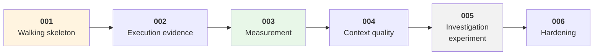

# Feature Specs

Spec Kit features for v1. Each one follows the delivery sequence in
[SRS Appendix A](../Docs/agentic-code-review-srs-v1.md#appendix-a--delivery-sequence), and each
**selects** requirements from the SRS — none adds one. Rules: [`.specify/memory/constitution.md`](../.specify/memory/constitution.md).

| # | Feature | Appendix A step | Core functions | Acceptance criteria it completes | Status |
|---|---|---|---|---|---|
| **001** | [Walking skeleton](./001-walking-skeleton/spec.md) | 1 | CF-1, CF-5, CF-7 · minimum of CF-6, CF-9 | AC-9, AC-13, AC-15, AC-16 · *starts* AC-1, AC-3, AC-10 | **In progress** — User Stories 1–2 and Phases 10–11 built; 35 of 149 tasks open ([plan](./001-walking-skeleton/plan.md), [tasks](./001-walking-skeleton/tasks.md)) |
| 002 | Execution evidence | 2 | CF-3 | AC-2, AC-7 | Not started |
| 003 | Measurement | 3 | CF-8 | AC-4, AC-5 | Not started |
| 004 | Context quality | 4 | CF-2, CF-4 | AC-1, AC-3, AC-6, AC-8, AC-10, AC-12, AC-14 | Not started |
| 005 | Investigation experiment | 4.5 | CF-6 | AC-11 | Not started — **may end in a revert**, by design |
| 006 | Hardening | 5 | CF-6 tuning, CF-9, FR-11.x | Re-verifies all seventeen | Not started |

**Why measurement is third, not last:** after 003, every change can be measured instead of argued
about — and 004 can be judged at depth 0 versus depth 1 on a fixed corpus.

**Before 001 is planned:** test S-1 from [`technical_stack.md`](../Docs/technical_stack.md) §7 — does
the default model call the finding tool reliably? — should run early in 001's plan. It is the
cheapest check in the project and it decides whether FR-5.6b's fallback is needed.
